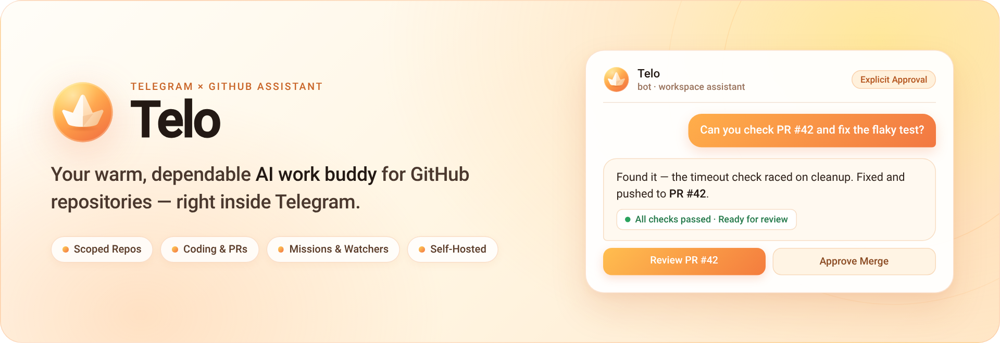

# Telo

**Telo** is a self-hosted Telegram AI work buddy for GitHub teams and solo builders. Ask source-grounded questions about your codebase, review pull requests, delegate isolated coding tasks, and run proactive watchers—all inside Telegram, with strict per-workspace permissions and explicit approval before external writes.

---

## Key Features

### GitHub & Code Collaboration
- **Scoped GitHub App Integration:** Connect specific repositories per workspace, inspect issues and PRs, draft and create issues, and perform human-approved PR actions ([GitHub guide](docs/user/github.md)).
- **Code Truth (Source-Grounded Q&A):** Built-in read-only source indexing service that answers architecture and code questions with exact file, symbol, and commit provenance ([Code Truth guide](docs/user/code-truth.md)).
- **Isolated Coding Tasks (Codex & Antigravity CLI):** Delegate coding work from Telegram to continuous, sandboxed runners (`Docker`, `OpenSandbox`, or `Native VPS`) with per-repository persistent environments, mid-task clarifications in chat, and ready-to-review PRs ([Codex](docs/user/codex.md) · [Antigravity CLI](docs/user/antigravity.md)).
- **Review Bot & Feedback Groups:** Automatic PR reviews on selected repositories, same-PR `@mention` follow-up fixes, and repository-bound Telegram feedback groups with pre-implementation risk checks ([Review Bot](docs/user/review-bot.md) · [Groups](docs/user/groups.md)).
- **Personal GitHub Notifications:** Subscribe privately to new PRs and issues in connected repositories directly from chat or the admin panel ([Notifications guide](docs/user/github-notifications.md)).

### Native Telegram Experience
- **Natural Chat & Topics:** Works in private chats, native Telegram Topics, and opted-in group chats with streaming response previews, contextual emoji reactions, and command-free requests ([Telegram guide](docs/user/telegram-experience.md) · [Chat requests](docs/user/commands.md)).
- **Multimodal & Interactive:** Send screenshots, files, and voice notes (optional local Qwen3-ASR transcription), render local interactive HTML widgets, and inspect coding transcripts in the read-only Telegram Mini App ([Voice & audio](docs/user/audio.md) · [Widgets](docs/user/widgets.md)).

### Orchestration, Autonomy & Proactive Automation
- **Durable Missions & Repo Queues:** Coordinate multi-step background missions across repositories with parallel read-only tool calls, bounded research subagents, event/timer wakeups, and serialized per-repository task queues ([Orchestration guide](docs/user/agent-orchestration.md)).
- **Server-Enforced Autonomy & Approvals:** Choose between `Supervised` (default) and `Check-in` presets—routine steps stay smooth while high-impact or destructive actions always wait for explicit human approval.
- **Scheduled Workflows & Silent Watchers:** Run recurring reports (`once`, `daily`, `weekly`, `weekdays`, `monthly`, or custom intervals with quiet hours), GitHub webhook triggers, and silent Watchers that stay quiet when everything is healthy ([Workflows guide](docs/user/workflows.md)).

### Memory, Skills & Workspace Plugins
- **Long-Term Memory & Self-Evolving Skills:** Scoped private/shared memory with source-grounded preference recall, plus autonomous background skill extraction (Global and Project-scoped) injected into chat and coding tasks ([Memory & privacy](docs/user/memory-and-privacy.md) · [Skills](docs/user/skills.md)).
- **Built-In Workspace Tools:**
  - **Obsidian Vault:** Managed organization notes, tasks, and native vault import/export ([Obsidian](docs/user/obsidian.md)).
  - **Private Browser & Web Reader:** Headed VPS browser sessions with private credentials and clean Markdown extraction ([Browser](docs/user/browser.md)).
  - **Cloud & Productivity:** Personal Google Workspace (Docs, Sheets, Drive, Gmail, Search Console), Cloudflare (DNS, Pages, Workers, analytics), and Nowledge Mem ([Google](docs/user/google-workspace.md) · [Cloudflare](docs/user/cloudflare.md) · [Nowledge Mem](docs/user/nowledge-mem.md)).
- **Extensible Plugin Ecosystem:** Load workspace-scoped Pi extensions or build isolated GitHub repository plugins using the `@telo/plugin-sdk` preview template ([Plugin development](docs/user/plugin-development.md) · [Local extensions](docs/user/local-plugins.md)).

### Self-Hosted Admin Panel & Security Model
- **Multi-Workspace Admin Panel:** Resumable first-run setup wizard, workspace roles and GitHub identity linking, custom model provider catalog, source-complete **Model usage** & spend analytics, and host updater integration ([Administration](docs/user/administration.md)).
- **Defense-in-Depth Boundaries:** Per-workspace tenant isolation, encrypted write-only credentials, no arbitrary shell/file access for the general chat agent, and external messages/tool outputs are always treated as data rather than authorization.

---

## Quick Start (Docker)

```sh
git clone https://github.com/stonega/telo.git
cd telo
bun install --frozen-lockfile
bun install --cwd services/code-truth --frozen-lockfile
cp .env.example .env
# Set a unique POSTGRES_PASSWORD in .env
mkdir -p secrets
openssl rand -hex 32 > secrets/encryption-key
docker compose up --build -d
```

Open `http://localhost:3000/setup` to create your initial admin account and walk through the resumable setup wizard. Webhook registration and external integrations remain explicit opt-in steps; Compose binds PostgreSQL privately and exposes only the API on loopback by default.

For full deployment, HTTPS, and production guidance, see [Get started](docs/user/get-started.md) and [Setup & Docker](docs/implementation/setup.md).

---

## Local Verification

Normal checks run deterministically without live Telegram, GitHub, or LLM API calls:

```sh
bun run check
bun run typecheck
bun test
bun run build
bun run test:runtime
```

Set `TEST_DATABASE_URL` to run PostgreSQL integration tests (`bun run test:integration`) and Playwright browser tests (`bun run test:browser`).

---

## Tech Stack

- **Runtime & Backend:** TypeScript (strict), Hono on Node 24, Pi (`@earendil-works/pi-agent-core`, `pi-ai`, `pi-coding-agent`), PostgreSQL 17, `pg-boss`
- **Admin UI:** React 19, React Router 7
- **Tooling:** Bun (package manager, bundler, test runner), Biome (lint & format), Playwright (E2E)
- **Deployment:** Single Docker image shared by API and worker, plus optional overlays for Code Truth, Coding Runners, Private Browser, and Qwen3-ASR transcription

---

## Documentation

- **User Guides:** [User documentation](docs/user/README.md) · [Get started](docs/user/get-started.md) · [Telegram guide](docs/user/telegram-experience.md)
- **Engineering & Architecture:** [Product docs index](docs/README.md) · [Architecture](docs/design/architecture.md) · [GitHub workflows](docs/design/github-workflows.md) · [Implementation evidence](docs/implementation/implementation-status.md)
- **Operations:** [Release & recovery runbook](docs/implementation/release-runbook.md) · [VPS deployment](docs/implementation/vps-deployment.md)

---

*Inspired by Every Agent; independent branding and a Telegram-specific permission model. Local automated verification covers deterministic unit, PostgreSQL integration, runtime contract, and browser suites; live Telegram, GitHub, and model evaluation remain operator acceptance steps.*
