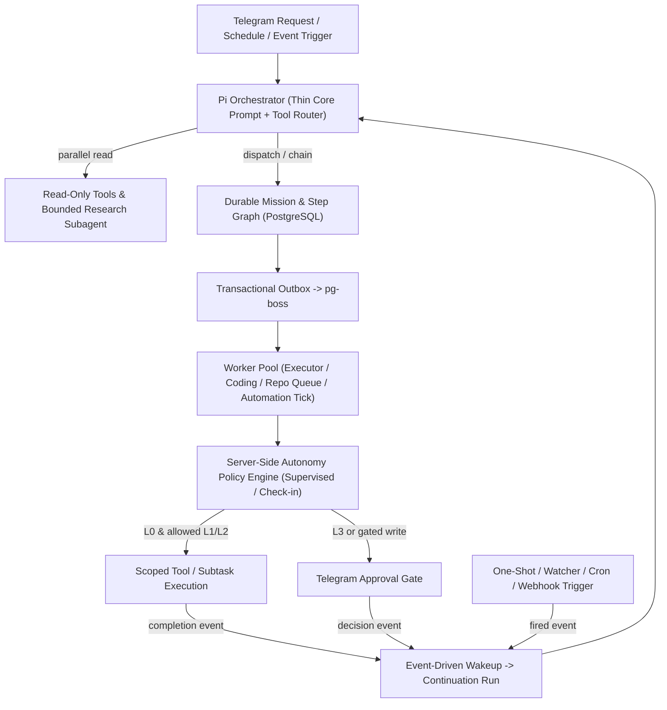

# Agent Orchestration, Autonomy, and Proactive Scheduling

Status: **Implemented locally (Phases 1–4, 2026-11-20)**. This document specifies the architecture
and product contracts for Telo's stateful, multi-step orchestration control plane.
Check [implementation evidence](../implementation/implementation-status.md) for
verified behavior and remaining live acceptance gates.

## 1. Product goals and interaction principles

Telo already provides scoped integrations across GitHub, Code Truth, Codex
coding/investigation/release tasks, Shared Host Browser, Web Reader, Search,
Cloudflare, Google Workspace, Obsidian, Nowledge Mem, and GitHub plugins, backed by
PostgreSQL, transactional `outbox`, `pg-boss`, execution fences, and human approvals.
What is missing is a unified **orchestration layer** that connects these capabilities
into end-to-end problem solving.

### Core UX principles

1. **Invisible implicit orchestration:** Users express goals in ordinary Telegram
   messages. The assistant silently decomposes complex goals, reads sources in
   parallel, delegates bounded research, queues coding work, waits for asynchronous
   completions or delayed checks, and reports synthesized outcomes—without spamming
   the chat with verbose step checklists or internal bookkeeping.
2. **Interrupt only when human judgment is needed:** After acknowledging a long
   background goal with at most one concise, natural receipt, the bot stays quiet
   while intermediate steps progress. It messages the user only for:
   - a required approval gate (always for L3 high-impact actions, or L1/L2 under
     `Supervised` policy),
   - an essential ambiguity or product decision that cannot be safely assumed,
   - the synthesized final outcome, or
   - an unrecoverable blocker or safety-limit halt.
3. **Always inspectable and controllable on demand:** Asking about progress in chat
   (or opening the Admin Panel) reveals active background missions, waiting
   conditions, queued repository items, and cancellation/reordering controls.
4. **Zero relaxation of tenant or identity boundaries:** Autonomy presets streamline
   non-destructive workflow steps without weakening tenant isolation, private-vs-group
   visibility separation, active membership checks, verified GitHub write access, or
   immutable L3 approval gates.

## 2. Unified architecture

All five capability pillars share one relational state and event-driven execution
model layered directly over existing Telo infrastructure:

## 3. Pillar 1: Execution core, concurrency, and prompt routing

### 3.1 Read-only tool concurrency

Currently `PiRunner` executes every tool sequentially (`toolExecution: "sequential"`).
Each application and extension tool declares an explicit concurrency and effect
metadata profile:

- `concurrency: "parallel"` — permitted **only** for idempotent read-only tools with
  no workspace/external mutation (e.g., `query_github_metadata`,
  `query_github_pull_request`, `find_connected_repository`, Code Truth queries,
  `read_web`, `search_tool`, `obsidian_query`, `obsidian_read`, `query_memories`,
  `query_discussions`, `query_chat_history`, `query_work_handoff`, `query_model_cost`,
  read-only Cloudflare/Google/Search Console/Nowledge Mem queries).
- `concurrency: "sequential"` — mandatory for all state-mutating, approval-creating,
  browser-controlling, or task-dispatching tools.

When a model turn emits multiple tool calls:
- Contiguous `parallel` calls run concurrently up to a bounded concurrency limit
  (default `4`), each running through the existing `beforeToolCall` / `afterToolCall`,
  abort signal, fence, and budget guards.
- Any `sequential` call acts as an execution barrier: preceding parallel calls settle
  and checkpoint in deterministic call order before the sequential call runs.
- Extension hooks (`tool_call` / `tool_result`) remain strictly observed without
  allowing input/output mutation.

### 3.2 Controlled read-only Research Subagent (`delegate_research`)

To keep the primary conversation context compact while gathering evidence across
multiple repositories, docs, or integrations, Pi gains a built-in application tool
`delegate_research`:

- **Execution model:** Spawns 1–3 bounded, independent read-only Pi sub-runs
  (synchronous fan-out inside the current run, or asynchronous mission step when
  attached to a background mission).
- **Hard sandbox boundaries:**
  - **Depth = 1:** Subagents never receive `delegate_research`, mission creation,
    scheduling, browser mutation, coding dispatch, or Telegram delivery tools.
  - **Read-only tool allowlist:** Only tools granted to the parent run whose metadata
    declares `readOnly: true` and `subagentSafe: true`.
  - **Strict scope inheritance:** Inherits the parent run's exact tenant, actor,
    chat/topic visibility (private vs group), group-repository binding, execution
    fence, and remaining run/workspace USD budget.
  - **Independent bounded budget:** Capped turns (default `6`), capped tool calls
    (default `12`), capped output bytes, and dedicated budget reservation settled into
    the parent run's accounting ledger.
  - **Structured return contract:** Returns concise findings, exact source citations
    or external provenance (URLs, commit SHAs, file:line, timestamps), unresolved
    unknowns, and whether any read was truncated—all marked as untrusted reference
    data.

### 3.3 Layered prompt and tool routing cleanup

`src/agent/context.ts` currently concatenates dense domain instructions for every
feature on every turn. This design refactors prompt assembly into two layers:

1. **Thin core orchestrator prompt (always loaded):**
   - Shared security & confidentiality policy (unchanged precedence).
   - Concise routing rubric: direct answer vs parallel read / `delegate_research` vs
     background Mission / Codex / Browser vs one-shot follow-up / automation.
   - Minimal capability summary of enabled integrations and current autonomy posture.
2. **Domain-scoped guidance (loaded on demand or bound to tool schemas):**
   - Detailed plugin procedures (widgets, Cloudflare, Google, Search Console,
     Obsidian, release workflows) stay attached to their respective tool descriptions
     or loaded skill resources rather than inflating unrelated turns.
   - Structural invariants (repository targeting, current-request verification,
     autonomy gating, anti-loop bounds) remain enforced in application services, not
     solely in prompt prose.

## 4. Pillar 2: Durable Mission & Event-Driven Continuation Engine

### 4.1 Removing the hard Codex handoff cutoff

Currently, setting `run.codingTaskId` forces `Executor` to suppress Pi's own response
and replace it with a fixed queue notice. Under the new orchestration model:

- Simple single-task coding requests continue to work seamlessly.
- Complex multi-step requests can attach one or more child tasks (`coding_task`,
  `research_subagent`, `approval`, `browser_wait`, `timer`, `github_event`) to a
  durable **Mission**, send one concise natural acknowledgement (or stay silent when
  fast), and automatically resume Pi when awaited dependencies finish.

### 4.2 Persistent data model (relational, tenant-scoped)

Two indexed tenant-scoped tables (`027_agent_orchestration.sql`) store orchestration
state with `ON DELETE CASCADE` on `workspaces(id)`:

- **`workspace_missions`**:
  - `workspace_id`, `id`, `actor`, `chat_id`, `topic_id`, `thread_id`, `bot_id`
  - `status`: `active | waiting | awaiting_approval | completed | failed | cancelled | halted`
  - `goal`: bounded summary of the user's original goal + immutable `origin_source_ids`
  - `autonomy_snapshot`: effective workspace/repo autonomy policy & revision at creation
  - `wakeup_count`, `max_wakeups` (default `8`), `auto_timer_count`, `max_auto_timers` (default `3`)
  - `budget_usd`, `spent_usd` (enforced alongside workspace monthly budget)
  - `fence`, `group_repository_version`, `last_run_id`, `error`, `created_at`, `updated_at`, `finished_at`
  - `state` JSONB: structured scratchpad/handoff artifacts (verified summaries, PR URLs,
    commit SHAs, Obsidian paths, provenance list) carried across continuations
- **`workspace_mission_waits`**:
  - `workspace_id`, `mission_id`, `id`, `join_group`, `join_mode` (`all | any`)
  - `kind`: `coding_task | approval | browser | timer | research | github_event`
  - `target_id` (e.g., coding task ID, approval ID, timer token, PR/commit filter hash)
  - `status`: `pending | satisfied | failed | cancelled | expired`
  - `due_at` (for `timer` waits and wait timeouts)
  - `result` JSONB (bounded verified outcome payload from the waited target)
  - `created_at`, `resolved_at`

### 4.3 Event-driven wakeup lifecycle

1. **Wait registration:** During a Pi run, orchestration tools (`manage_mission`,
   `dispatch_coding_task`, `schedule_mission_followup`, or gated approval creation
   linked to a mission) register one or more `workspace_mission_waits` rows inside the
   tenant transaction and transition the mission to `waiting` (or `awaiting_approval`).
2. **Completion hook:** When a waited target resolves:
   - Coding task enters terminal/review/waiting state (`src/coding/tasks.ts`),
   - Approval is decided (`src/workflows/service.ts` / `decide`),
   - Browser wait resumes (`src/browser/pause.ts`),
   - Timer wait reaches `due_at` (worker maintenance tick),
   - Research subagent finishes, or
   - Matching GitHub webhook event arrives (e.g., `check_suite.completed` for a watched
     PR head SHA),
   the resolving transaction updates the matching `workspace_mission_waits` row with its
   bounded outcome.
3. **Join evaluation & atomic wakeup:** If the wait's `join_group` is satisfied (`all`
   waits resolved or `any` wait resolved), the same PostgreSQL transaction:
   - increments `wakeup_count` and enforces `wakeup_count <= max_wakeups`,
   - creates a linked **Continuation Run** (`run.missionId = mission.id`,
     `run.trigger = "mission_wakeup"`), and
   - inserts a `run` row into `outbox` so `pg-boss` wakes `Executor` deterministically.
4. **Silent suppression of redundant child notices:** When a child Codex task belongs
   to an active Mission, routine intermediate notices are suppressed from the main chat
   (still recorded in task history/Mini App) so the Mission delivers one clean
   synthesized update when ready—unless the child enters `waiting` (needs user input)
   or `auth_required`.
5. **Re-authorization on every wakeup:** Before executing a Continuation Run, `Executor`
   re-verifies:
   - deployment active & unpaused, workspace active & unpaused,
   - `mission.actor` active membership and chat/topic audience,
   - unchanged bot identity, group-repository binding version, and GitHub write access
     for any repository-mutating step,
   - current autonomy policy (if policy was tightened to `Supervised` since mission
     start, previously automatic actions immediately downgrade to approval-gated),
   - budget headroom and non-cancelled mission status.
6. **User steering & cancellation:** If the user sends a follow-up message in the same
   conversation referencing or correcting the active mission, Pi can inspect, steer,
   or cancel the mission and its pending waits/child tasks cleanly.

### 4.4 Autonomous one-shot delayed follow-ups

Within an active Mission (or interactive request asking to monitor/check back later),
Pi can register a bounded `timer` wait (`schedule_mission_followup`) **without asking
extra user confirmation**, subject to hard server-side bounds:
- Delay between `1 minute` and `72 hours`.
- At most `max_auto_timers` (default `3`) autonomous timers per Mission; consecutive
  timers without state change trigger a circuit breaker that stops and reports current
  status to the user.
- Explicit user-requested one-shot reminders/tasks (e.g., "remind me tomorrow at 10:00
  to check X") use the unified Automation Trigger engine (Section 6) instead.

## 5. Pillar 3: Server-Enforced Autonomy Policy Engine

### 5.1 Action classification

Every mutating tool or side effect maps deterministically on the server to an
`ActionClass` (models cannot override or self-classify actions):

| Class | Scope & examples | `Supervised` | `Check-in` |
| :--- | :--- | :--- | :--- |
| **L0 — Read & Observe** | All read-only queries, `delegate_research`, read-only Codex `investigation`, silent Watcher checks, bounded Mission delayed follow-up checks | Automatic | Automatic |
| **L1/L2 — Routine Non-Destructive Writes** | Create/update Draft or Ready PR (from verified Codex patch), create/comment/label GitHub Issue, write/update Obsidian organization notes, save sanitized skill draft / repository lesson draft, non-destructive Cloudflare/automation config updates | Approval required (existing behavior; explicit interactive Obsidian requests preserved) | **Automatic** with full audit entry & provenance receipt |
| **L3 — High-Impact / Destructive (Immutable Gate)** | **Merge PR**, **Close PR**, **Publish GitHub Release / Tag / Asset**, **Delete/Destroy** resources (Cloudflare DNS/Pages delete, Obsidian permanent erase, workspace deletion, branch deletion), **Change permissions / membership / autonomy policy / secrets** | **Mandatory human approval** | **Mandatory human approval** |

### 5.2 Configuration hierarchy and invariants

- **Workspace default autonomy preset:** `supervised` (default for all existing and
  new workspaces so upgrades never silently broaden write authority) or `check_in`.
- **Per-repository override:** Each connected GitHub repository can override the
  workspace default (`inherit | supervised | check_in`).
- **Admin/Owner-only mutation:** Changing workspace or repository autonomy presets is
  an L3 operation restricted to workspace owners/admins via the Admin Panel (with
  optimistic revision checks and audit logging). Chat requests cannot self-elevate
  autonomy.
- **Per-action verification preserved under `Check-in`:**
  - Automatic GitHub writes still require verified GitHub write access for the
    requesting `actor`, valid installation/connection revision, and group-repository
    binding compliance.
  - Automatic writes in group chats never leak private context or act on another
    member's unverified request.
  - Every automatic L1/L2 write records an immutable `workspace_audit` entry tagged
    `autonomy_mode: "check_in"` plus target provenance, and is summarized in the final
    reply to the user.
  - Approval-gated actions executed inside a Mission still pause cleanly via
    `workspace_mission_waits(kind="approval")`; once approved, the Mission
    automatically resumes remaining steps.

## 6. Pillar 4: Upgraded Proactive Scheduling & Event-Driven Automations

Telo's `workflows` subsystem expands from `daily`/`weekly` text reports into a
unified **Automations** engine while keeping full backward compatibility with all
existing saved schedules.

### 6.1 Trigger types

1. **One-shot (`once`):** Single `runAt` timestamp (IANA timezone validated). After
   execution (or expiry past missed-run window), transitions to `completed` rather
   than repeating.
2. **Recurring (`daily` | `weekly` | `weekdays` | `monthly` | `interval`):**
   - `daily`: local `hour:minute` (existing).
   - `weekly`: local `weekday` (1–7) + `hour:minute` (existing).
   - `weekdays`: Monday–Friday at local `hour:minute`.
   - `monthly`: local `dayOfMonth` (1–28, or `"last"`) + `hour:minute`.
   - `interval`: every `intervalMinutes` (bounded `15` to `1440`, optional quiet hours).
3. **Event-driven (`github_event` | `plugin_event`):**
   - `github_event`: bound to explicit `repositoryIds` and supported event filters:
     - `check_suite_failed` (optional branch filter, e.g., default branch),
     - `issue_opened` / `issue_labeled` (optional label filter),
     - `pull_request_opened` / `pull_request_ready`.
     Consumes events from the existing HMAC-verified GitHub webhook ingress with
     semantic deduplication and per-automation cooldown (default `15 minutes`).
   - `plugin_event`: subscribes to declared notification events from an installed,
     enabled GitHub plugin (pinned to installation generation).

### 6.2 Delivery mode: `always` vs Watcher (`on_condition`)

Automations gain `deliveryMode: "always" | "on_condition"` (default `"always"` for
backward compatibility):

- Under **`on_condition` (Watcher mode)**, the workflow run receives a dedicated
  application tool `report_watcher_result({ notify: boolean, summary?: string, dedupeKey?: string, startInvestigation?: { repositoryId, reason } })`:
  - If `notify === false`, the run finishes cleanly as `succeeded (silent)`, creates
    **no** Telegram delivery, and logs an audit entry.
  - If `notify === true`, the application checks a per-automation `dedupeKey` cooldown
    window (avoiding alert storms for an unchanged outage) before delivering.
  - Optionally, when permitted by repository permissions and workspace policy, a
    Watcher can trigger a bounded read-only Codex `investigation` (L0) and deliver
    the combined root-cause summary once ready—never an unauthorized write.

## 7. Pillar 5: Per-Repository Task Queue & Cross-Repository Coordination

### 7.1 Per-repository sequential task queue

A new relational table `workspace_repo_queue` (`028_repo_queue.sql`) serializes coding
work targeting the same repository to prevent branch conflicts, quota thrashing, and
stale base-branch races:

- **Queue operations:** `enqueue`, `pin` (move to front of queued items), `reorder`,
  `pause_queue`, `resume_queue`, `cancel_item`.
- **Execution semantics:**
  - At most one `running` coding task per `(workspace_id, repository_id)` (configurable
    concurrency default `1`).
  - When the active item completes, fails, or is cancelled, the worker atomically
    promotes the highest-priority `queued` item (respecting `paused` queue state) and
    rechecks the item's `actor` membership, GitHub write access, and group binding
    before starting Codex.
- **Verified artifact carryover:** Each queued item can declare
  `carryoverFromPrevious: boolean` (default `true` for items submitted in the same
  mission/thread). When promoted, the application injects a bounded, read-only
  verified artifact summary from the immediately preceding succeeded item in the same
  scope (commit SHA, branch name, PR number/URL, verified summary) — never cross-actor
  private data or unverified claims.

### 7.2 Cross-repository parent-child coordination

A single Mission can orchestrate work across multiple connected repositories:

- **Parallel fan-out:** Independent tasks on Repo A and Repo B enqueue onto their
  respective repository queues simultaneously and share a `workspace_mission_waits`
  `join_group` with `join_mode = "all"`. When both finish, Pi wakes up to synthesize
  a unified report.
- **Dependent chain:** When Repo B depends on Repo A's change (e.g., API repo →
  docs/landing repo), the Mission enqueues Repo A first; upon Repo A completion, the
  Continuation Run binds Repo A's resulting commit/PR as a commit-pinned read-only
  `reference-source` (reusing Telo's existing verified reference-source pipeline)
  and dispatches Repo B.
- **Coding Worker Adapter seam:** Queue scheduling and Mission coordination interact
  with coding execution through an abstract `CodingWorkerAdapter` interface (initially
  implemented by the existing Codex runner), keeping the door cleanly open for
  interchangeable workers (e.g., Claude Code) without redesigning orchestration.

## 8. Admin Panel UI and HTTP API contracts

All new and updated Admin Panel surfaces follow [UI design rules](ui-rules.md) and
the [UI implementation and completion checks](../../AGENTS.md#ui-implementation-and-completion-checks):

### Applicable UI rules and acceptance criteria

- **Saved display vs modal editors** ([Modal editors](ui-rules.md#add-and-create-flows-use-modals)):
  Saved repository autonomy presets, active/historical missions, repository queue
  items, and automation definitions render as read-only summaries/tables. Creating or
  editing presets or automations uses shared `Modal` dialogs with `ModalActions`
  (primary action before Cancel, plain `X` close, pending dismissal lock, retained
  drafts on error, focus return).
- **Card action placement & icons** ([Card actions](ui-rules.md#card-actions-stay-at-the-top-right),
  [Shared icons](ui-rules.md#common-action-buttons-use-reicon)): Top-right Edit/New
  actions, borderless row edit icons where tables are used, shared `Select` dropdowns,
  `ErrorToast`/`useToast` feedback, and visible `Skeleton` loading states.
- **Container spacing** ([Card spacing](ui-rules.md#content-layout-owns-card-spacing)):
  No empty wrappers or uneven top/bottom gaps when sections are empty or filtered.
- **Verification targets:** Desktop (`1280px`) and mobile (`390px`), both light and
  dark themes, across saved/empty/loading/pending/error states.

### Admin Panel screens and endpoints

1. **Autonomy Policy configuration** (on Workspace Settings & GitHub Connected Repositories):
   - Saved summary displays Workspace Default Autonomy (`Supervised` / `Check-in`)
     and per-repository effective autonomy badge (`Inherit` / `Supervised` / `Check-in`).
   - Edit modal updates workspace default or a repository's autonomy override with
     optimistic revision check and explicit note that L3 high-impact actions remain
     mandatory human approvals.
   - API: `GET/PATCH /api/admin/workspaces/:id/autonomy` and
     `PATCH /api/admin/workspaces/:id/github/repositories/:repoId/autonomy`.
2. **Missions & Repository Queues view** (new `Missions` workspace sub-view or
   integrated section alongside Runs/Tasks):
   - **Missions card:** Paginated table of active, waiting, and recent missions
     showing goal summary, actor, status pill, waiting-on summary, wakeup count,
     spent USD, and link to detail view; detail view shows child waits/steps,
     artifacts, and a **Cancel mission** action (with confirmation modal).
   - **Repository queues card:** Grouped by connected repository showing queue state
     (`Active` / `Paused`), currently running item, ordered queued items, and
     controls for **Pause/Resume queue** (single opposite-state button), **Pin to
     front**, and **Cancel item**.
   - Visibility boundary: respects existing workspace/member privacy rules (operators
     without member access do not inspect private conversation bodies).
   - API:
     - `GET /api/admin/workspaces/:id/missions`
     - `GET /api/admin/workspaces/:id/missions/:missionId`
     - `POST /api/admin/workspaces/:id/missions/:missionId/cancel`
     - `GET /api/admin/workspaces/:id/queues`
     - `POST /api/admin/workspaces/:id/queues/:repoId/pause` / `resume`
     - `POST /api/admin/workspaces/:id/queues/:repoId/items/:itemId/pin` / `cancel`
3. **Upgraded Automations screen** (`web/pages/workflows-skills.tsx`):
   - Extends existing saved workflow cards and Edit/New modal to support:
     - Trigger type selector (`Daily`, `Weekly`, `Weekdays`, `Monthly`, `Interval`,
       `One-shot`, `GitHub event`, `Plugin event`) using shared `Select`,
     - Delivery mode (`Always notify` vs `Notify only on condition (Watcher)`),
     - Event filter fields & cooldown minutes when event-triggered,
     - Clear saved-summary display of trigger type, next occurrence / event filter,
       and last silent vs notified outcome.
   - Existing `daily`/`weekly` workflows render and edit identically without migration
     breakage.

## 9. Security, privacy, and reliability invariants

1. **Zero external startup calls:** All new built-in orchestration tools and adapters
   register from bundled definitions and local state only. Add them to
   `scripts/fixtures/plugin-startup.ts` and verify zero external HTTP calls across
   all startup cases and `dist/runtime-contract.js`.
2. **Fail-closed re-authorization:** Every wakeup, promoted queue item, Watcher
   trigger, and subagent call rechecks active membership, audience, bot ID, group
   repository binding, GitHub write permission, and autonomy revision. Stale or
   revoked state halts cleanly without executing side effects.
3. **Private-vs-group isolation:** Private memories, browser profiles, private chat
   history, and personal credentials never cross into group missions, group queues,
   or shared carryover summaries.
4. **Anti-runaway bounds:** Hard caps on concurrent read tools, subagent depth (`1`),
   subagent turns/tools, mission wakeups (`8`), autonomous timers (`3`), watcher
   cooldowns, and USD budgets prevent infinite loops and runaway API spend.
5. **Durable idempotency & crash recovery:** Outbox + `pg-boss` + PostgreSQL row
   locks + monotonic fences ensure worker restarts never double-execute writes,
   double-promote queue items, or lose a pending mission wakeup.
6. **Sanitized observability:** Fixed diagnostic codes (`mission_wakeup_limit`,
   `autonomy_l3_approval_required`, `subagent_budget_exceeded`, `queue_item_revoked`,
   etc.) with tenant/run/mission IDs; never log raw credentials, upstream exceptions,
   or private message bodies.
