# GitHub plugin contract

Status: **proposed RFC, 2026-11-13**. This document defines a candidate third-party
contract, not implemented behavior. SDK names, API versions, routes and commands
below are proposed. Follow the [current Pi extension contract](llm-extensions.md)
for working local extensions. See [research](../research/plugin-ecosystems-2026-11-13.md)
and the [delivery plan](../implementation/github-plugins-plan.md).

## Product contract

One GitHub repository is one installable plugin. A plugin can contribute several
read-only tools, settings and optional Markdown skills. An author implements tool
handlers; RepoDesk supplies installation, configuration UI, identity, connection
management, Pi registration, authorization, cancellation and durable results.

The first public profile supports pure computation, approved read-only HTTP
operations and a scoped GitHub repository-metadata adapter. It does not expose
conversation hooks, raw chat history, model/provider APIs, direct messaging,
external writes, persistent plugin state, scheduled callbacks or custom frontend
code. Existing application-owned integrations retain their existing contracts.

The package format does not turn existing Pi extensions into isolated plugins.
Keep the trusted local-file path as a separate compatibility profile. GitHub
installation must never fall back to importing code inside the API/worker process
when a sandbox is missing or a package is incompatible.

## Repository template

```text
repodesk-plugin-example/
├── repodesk.plugin.json       # Sole authority for metadata and contributions
├── package.json              # Private build package; matching version
├── bun.lock                  # Exact author build dependencies
├── tsconfig.json             # Strict TypeScript
├── biome.json
├── src/index.ts              # Tool handlers
├── src/generated/contract.ts # CLI-generated schema types
├── dist/plugin.mjs           # Committed, self-contained ESM bundle
├── skills/repository-summary/SKILL.md  # Optional instructions
├── tests/tools.test.ts       # Deterministic handler tests
├── tests/contract.test.ts    # SDK contract and denied-capability fixtures
├── .github/workflows/check.yml
├── README.md
├── CHANGELOG.md
├── SECURITY.md
└── LICENSE
```

The installer reads the root manifest and explicit resource paths only. There is
no recursive plugin discovery, `.pi` discovery, glob expansion or execution of
`package.json` scripts. `package.json` manages author tooling, not platform grants.
The SDK build must bundle runtime dependencies; production loading must not need
`node_modules`, TypeScript compilation or an npm registry connection. Native
addons and external runtime imports are unsupported in the initial profile.
Keep the committed bundle readable and unminified for review, and include required
third-party license notices. The operator reviews the executed bundle as well as
source; successful CI or source-only review does not prove those bytes are safe.

The template's CI runs lint, strict types, deterministic tests, manifest/schema
validation and a fresh bundle build, then fails if the committed bundle differs.
Pin toolchain versions and CI actions to reviewed immutable versions/commits.
Signing or attestations can add source evidence but do not establish code safety.

## Manifest

Illustrative complete minimal manifest for a repository-summary plugin:

```json
{
  "schemaVersion": 1,
  "id": "repository-insights",
  "name": "Repository insights",
  "description": "Read current counters for an authorized GitHub repository.",
  "version": "0.1.0",
  "apiVersion": "1",
  "license": "MIT",
  "repository": "https://github.com/example/repodesk-repository-insights",
  "publisher": { "name": "Example" },
  "runtime": { "type": "node-sandbox", "entry": "dist/plugin.mjs" },
  "capabilities": ["github.metadata.read"],
  "settingsSchema": {
    "type": "object",
    "properties": {},
    "additionalProperties": false
  },
  "tools": [
    {
      "name": "repository_summary",
      "title": "Repository summary",
      "description": "Read current stars, forks and subscribers. Cannot infer historical changes.",
      "effect": "read",
      "capabilities": ["github.metadata.read"],
      "inputSchema": {
        "type": "object",
        "properties": { "repositoryId": { "type": "integer", "minimum": 1 } },
        "required": ["repositoryId"],
        "additionalProperties": false
      },
      "outputSchema": {
        "type": "object",
        "properties": {
          "url": { "type": "string", "maxLength": 2048 },
          "stars": { "type": "integer", "minimum": 0 },
          "forks": { "type": "integer", "minimum": 0 },
          "subscribers": { "type": "integer", "minimum": 0 },
          "fetchedAt": { "type": "string", "maxLength": 64 }
        },
        "required": ["url", "stars", "forks", "subscribers", "fetchedAt"],
        "additionalProperties": false
      }
    }
  ],
  "skills": []
}
```

| Field | Contract |
| --- | --- |
| `schemaVersion` | Integer manifest format version; initially `1` |
| `id` | Display/catalog slug, lowercase letters, digits and hyphens, 2–64 characters; not global authority |
| `name`, `description` | Plain text, at most 100/1,024 characters; rendered as untrusted text |
| `version` | SemVer package version, equal to `package.json`; production tags are exactly `v<version>` |
| `apiVersion` | Host SDK protocol major, initially draft `"1"`; unknown majors or capabilities fail before execution |
| `license`, `repository`, `publisher` | License identifier/expression, canonical source URL and display attribution; publisher text grants no verified badge |
| `runtime` | Initial enum `node-sandbox`; entry is an explicit `.mjs` regular file inside the package |
| `capabilities` | Requested capability ceiling; default empty; not a grant |
| `settingsSchema` | Nonsecret operator configuration; defaults materialized and validated by the host |
| `connections` | Optional declarative credential bindings; default empty; see below |
| `diagnosticCodes` | Optional list of at most 32 fixed lowercase/underscore codes, each at most 64 characters; no free-text messages |
| `tools` | 1–32 static definitions; names match `^[a-z][a-z0-9_]{0,31}$`; unique within the plugin |
| Tool `capabilities` | Per-tool subset of the package ceiling; only that subset reaches this invocation |
| Tool `effect` | Initial values `compute` or `read`; reviewed semantics, never inferred from a function name or HTTP method |
| Tool schemas | Required object input/output schemas; validate on both sides of execution |
| `skills` | Explicit `{ "path": "skills/name/SKILL.md" }` entries; default empty; bundled instructions cannot grant tools |

Unknown fields fail validation except an optional bounded `metadata` string map.
Schema support initially includes objects, arrays, primitive types, properties,
required, enum, const, additionalProperties and bounded length/item/numeric
constraints. Object schemas require `additionalProperties: false`. No remote
`$ref`, executable defaults, coercion, custom formats or schema extensions.
Publish the precise local schema and test corpus before declaring API `1` stable.
Version the SDK/protocol independently of the application and Pi dependencies.
Additive broker APIs must have explicit manifest capability requirements so an
older host rejects unsupported packages during preview. Breaking changes require
a new API major and an explicit host support matrix.

Settings support scalar fields, enums and bounded arrays using shared native
controls. Optional `settingsUi` metadata may provide field labels, help text and
order referencing schema properties; it cannot contain HTML, JavaScript, arbitrary
CSS, URLs to renderers or executable validation. Unsupported schema widgets fail
validation rather than becoming an arbitrary JSON editor for ordinary users.

## Identity and source ownership

Resolve GitHub's numeric repository ID and owner ID during preview. The platform
identity is `github:<repositoryId>`; the manifest slug and repository name are
labels. Forks receive distinct identities even if they copy the manifest unchanged.
Renames preserve repository identity; owner transfers require new operator review.
Deleting and recreating an identically named repository cannot inherit an install.

The host maps local tool names to `rdp_<repositoryId>_<localName>`, within its
64-character tool-name budget, and stores that mapping with the installation.
Reserve built-in names and reject all collisions. Bundle skills with the same
source identity and translate their declared local tool references through this
mapping. Text instructions remain untrusted and cannot acquire additional tools.

Installations are workspace-scoped. Any shared artifact cache is content-addressed
storage behind authorization, not a public inventory of private source names.
Source credentials are restricted to the selected repository and never supplied
to the plugin. A source-repository grant and a data-repository grant are separate.

## Author SDK

Proposed package: `@repodesk/plugin-sdk`; proposed command package:
`@repodesk/plugin-cli`. Neither is published or implemented by this RFC. Authors
should not attempt these imports/commands against today's platform.

The public SDK has one definition function and a per-call context. It does not
re-export `ExtensionAPI` or expose application services, database objects or
ambient credentials. A simplified TypeScript contract is:

```typescript
type Json = null | boolean | number | string | Json[] | { [key: string]: Json };
type JsonObject = { [key: string]: Json };
type ToolContracts = Record<string, { input: JsonObject; output: JsonObject }>;

interface RepositorySummary {
  url: string;
  stars: number;
  forks: number;
  subscribers: number;
  fetchedAt: string;
}

interface ToolContext<Settings> {
  readonly signal: AbortSignal;
  readonly settings: Readonly<Settings>;
  readonly invocation: Readonly<{ id: string; deadline: string }>;
  readonly github: {
    getRepository(input: { repositoryId: number }): Promise<RepositorySummary>;
  };
  readonly http: {
    request(connection: string, input: {
      path: string;
      query?: Record<string, string>;
    }): Promise<{ status: number; data: Json }>;
  };
  readonly diagnostics: {
    emit(code: string): void;
  };
}

interface ToolResult<Output> {
  content: { type: "text"; text: string }[];
  structuredContent: Output;
}

type PluginDefinition<Contract extends ToolContracts, Settings> = {
  tools: {
    [Name in keyof Contract]: (
      input: Contract[Name]["input"],
      context: ToolContext<Settings>,
    ) => Promise<ToolResult<Contract[Name]["output"]>>;
  };
};

declare function definePlugin<C extends ToolContracts, S = JsonObject>(
  definition: PluginDefinition<C, S>,
): PluginDefinition<C, S>;
```

Input/output/settings types should be generated from the manifest by the SDK CLI
so authors do not maintain a second schema. Generation never executes plugin
code. The runner requires exactly the manifest's handler names and rejects missing
or undeclared handlers. TypeScript types improve authoring; host validation is the
runtime boundary.

Illustrative `src/index.ts`, using the proposed generated contract:

```typescript
import { definePlugin } from "@repodesk/plugin-sdk";
import type { Contract, Settings } from "./generated/contract.js";

export default definePlugin<Contract, Settings>({
  tools: {
    async repository_summary({ repositoryId }, context) {
      context.signal.throwIfAborted();
      const data = await context.github.getRepository({ repositoryId });
      return {
        content: [{ type: "text", text: JSON.stringify(data) }],
        structuredContent: data,
      };
    },
  },
});
```

Importing a module and defining its handlers must have no external I/O. The host
can validate this expectation in a sandbox, but must remain safe even when a
malicious module violates it. The first profile needs no activation hook: create
one sandbox per tool invocation, invoke one handler, then terminate it. Module
globals do not persist between calls. The host owns all durable lifecycle state.

Proposed author loop, after these packages exist:

```text
Use the official GitHub template → change metadata and capabilities
bun install --frozen-lockfile
bun run generate
bun run check
bun run typecheck
bun test
bun run build
bun run validate
Commit the manifest, source, lockfile and generated dist/plugin.mjs
Tag v0.1.0 at that commit → paste the repository URL into RepoDesk
```

Template scripts will pin the CLI/toolchain and invoke it locally; installation
will never run those scripts. A local `dev` harness must show requested broker
operations, fixture results and denials without a live bot, model or credential.
Real-service testing is an explicit opt-in using isolated test connections.

## Capability and connection boundary

Effective access is the intersection of host support, reviewed package/tool
requests, workspace policy, current actor/resource access, bound connection and
run/workflow restrictions. If a skill is selected, its restrictions also apply.
A run without a skill gains no additional plugin capabilities.

The broker binds workspace, verified actor, bot, destination, run, call ID,
installation generation, package digest and cancellation to a host-owned session.
Plugins cannot send replacement tenant IDs, credentials, approval flags or another
call ID. Even a well-formed repository ID must pass current resource checks.
Authorization runs before dispatch, every broker operation, result reuse and
delivery; it is not delegated to SDK code.

Initial capabilities:

| Capability | Broker behavior |
| --- | --- |
| None | Computation over the validated arguments only |
| `github.metadata.read` | Fixed repository-metadata operation through the existing GitHub service; selected repositories and current actor permissions are rechecked |
| `http.read` | GET requests through reviewed connection origins/path rules and current connection consent; response size/time/network policies enforced |

For an external service, add a connection descriptor such as:

```json
{
  "id": "tickets",
  "name": "Ticket service",
  "scope": "member",
  "auth": { "type": "bearer" },
  "requests": [
    {
      "origin": "https://api.example.com",
      "paths": ["/v1/tickets"],
      "queryKeys": ["status", "page"]
    }
  ]
}
```

This is one item in the optional `connections` array; its package/tool must also
request `http.read`. Initial auth types are `none` and `bearer`; the host handles
write-only token entry, encryption and provider headers. There is no `getSecret`.
Member bindings require that member's explicit connection; workspace bindings
require operator setup and an explicit member-use policy. Never silently choose
another member's connection or a workspace token when personal access fails.
Initially member bindings are private-conversation-only, including result reuse
and delivery. Workspace bindings still require approved destination/workflow
scope; a connection does not authorize posting its data into every chat.

The initial path list contains exact normalized paths; dynamic path templates and
user-supplied base URLs are deferred. Query values are bounded and validated by
tool schemas; query keys are allowlisted. Plugins cannot supply headers, methods,
credentials, absolute URLs or request bodies. The host injects the bearer token
only for its bound HTTPS origin and strips authentication/cookies from responses.
Redirects are disabled initially. Reject encoded path traversal, userinfo, private,
loopback, link-local and metadata addresses; recheck resolved addresses at connect
time to prevent DNS rebinding. Do not inherit ambient proxy credentials.

An approved GET endpoint may still have side effects. Review service semantics,
data sent in paths/queries and the receiving provider during install consent.
All tool arguments and returned broker data are visible to plugin code; minimize
them. An allowed external origin can receive those data, so domain consent must
describe this disclosure. Never grant raw transcript access through this API.

OAuth, arbitrary header injection, file upload, pagination helpers and provider
discovery adapters need separate contracts before being added. Built-in Google,
Browser, Cloudflare and other integrations do not become generic plugin grants.

## Installation and immutable artifacts

1. An authenticated deployment operator opens **New → GitHub repository** in the
   selected workspace. Accept a canonical HTTPS GitHub root URL; choose a version
   tag or full commit in a separate field. Reject arbitrary hosts, credentials,
   Git transport URLs, nested paths and shell-like source specifications.
2. Resolve repository/owner identity and selected ref through GitHub. For a root
   URL, suggest the highest compatible stable `v<SemVer>` tag, never silently
   install a default branch. A repository without tags can use an explicitly
   selected full commit for development. Resolve annotated tags to their commit.
3. Fetch the manifest and archive at the same full commit, using fixed GitHub API
   endpoints. Public sources need no credential; private sources reuse the
   operator's current selected-repository GitHub App with Contents-read tokens.
   The fetched archive redirect must be HTTPS on an explicitly supported GitHub
   download origin; strip authorization on the cross-origin download request.
4. Extract into staging without running code, following bounded archive rules.
   Validate manifest, bundle/resources and compatibility; compute the complete
   package content digest. No npm install, Git hooks, submodules, LFS resolution,
   postinstall script or author build command runs on the platform.
5. Return a bounded preview: source/owner, resolved version, code and permissions,
   requested external destinations, configuration/connection requirements,
   bundled skills and review warnings. Bind an expiring preview ID to operator,
   workspace, current revision, source identity, commit and digest.
6. **Install** rechecks current operator/source access, workspace revision,
   repository/owner identity and the selected tag's commit. If a tag moved or the
   candidate bytes changed, reject the stale preview. Atomically save a disabled
   workspace installation pointing to the exact staged artifact.
7. Validate configuration/connections and enable explicitly. Enabling does not
   probe remote services or grant every member access to a private connection.
   Missing runner/service readiness is shown; existing unrelated tools still work.

Candidate initial caps: 64 KiB manifest, 10 MiB compressed archive, 32 MiB
uncompressed package, 512 regular files, 5 MiB bundle and 32 tools. Enforce streamed
byte/file/depth limits before extraction completes. Reject absolute paths, `..`,
duplicate normalized paths, symlinks, hard links, device files, executable helpers,
submodules and files outside the archive's single repository root. No silent
partial install. Skill text/resources retain the [existing skill limits](agent-skills.md).

Store repository ID, reviewed owner ID, canonical URL, selected ref, full commit,
manifest hash, sorted path/content-hash package digest, bundle hash and host runner
image digest. The package digest covers every installed resource and dependency,
using canonical relative paths and file bytes, not GitHub's compressed tar bytes.
Cache verified files locally so ordinary invocations need no GitHub access.
Digests establish identity; reviews and runtime policy establish usable access.

Repository deletion, a private-source permission failure or a moved tag blocks
new installs/updates without replacing the approved artifact. Existing execution
still requires an active installation and current data-connection authorization;
source visibility is not an implicit data grant. An explicit local revocation of
the plugin installation immediately blocks new work. Document source access and
runtime grants separately in the operator guide.

## Runner and Pi integration

```mermaid
flowchart LR
  G[GitHub commit] --> I[Installer: data validation and hashing]
  I --> A[Verified local artifact]
  A --> C[Static tool catalog]
  C --> P[Pi: host-owned tool adapter]
  P --> L[Run guard and durable call reservation]
  L --> R[Isolated plugin invocation]
  R <-->|bounded RPC| B[Host capability broker]
  B --> S[Authorized application services]
```



The API/worker reads static definitions only. An unavailable plugin runner, a
missing credential or an upstream outage cannot prevent a greeting. Third-party
code is not imported to list tools, render settings, save settings or start Pi.

Use a host-controlled runner image pinned by digest and a new restricted sandbox
for each tool call: non-root user, read-only root/package filesystem, bounded
scratch tmpfs, no external network, dropped capabilities, no new privileges,
seccomp, CPU/memory/PID/time/output limits and no application environment, host
mounts, database access or Docker socket. The runner supervisor is trusted and
separate from the plugin; the plugin has only a narrow framed broker channel.
Do not expose an unrestricted container-management endpoint to the worker or plugin.

A Node child process, worker thread or `vm` is insufficient isolation by itself.
This container profile shares the host kernel; prove its controls and record
residual risk before public release. A deployment that requires a stronger
boundary can use a microVM-backed runner without changing author tool handlers.

Protocol `1` uses bounded JSON-RPC 2.0 frames over a dedicated local channel;
method names are RepoDesk-specific, so this is not an MCP server claim. Require
`initialize`/version negotiation, one `tool.invoke`, broker requests, bounded
progress codes, `cancel` and a terminal result. Host-owned framing/request IDs,
deadlines and session bindings reject cross-call, late, duplicate, oversized and
unknown-method frames. No raw stdout/stderr forwarding to users or routine logs.
The SDK hides transport details. The release schema will define every method's
request, response and error shape; this RFC is not a complete wire specification.
Kill the sandbox after terminal completion or a
bounded cancellation grace period, including hung top-level module imports.
Termination must include every descendant process in the sandbox's resource group.

Initial defaults to benchmark: 30-second call deadline, 256 MiB memory, one CPU,
32 PIDs, 16 MiB scratch, 64 KiB input, 256 KiB result/frame and 10 broker requests
per call. Host deployment policy and remaining run/model budgets can only reduce
these limits; a manifest cannot raise them. Startup/import is part of the deadline.

Pi keeps selecting and invoking tools. The adapter preserves sequential execution,
current run guards, budget accounting and existing tool reservations; results
validate against the reviewed output schema before persistence or model exposure.
Tool text is external data, not authorization. Returned links do not trigger fetches.
Model-visible failures use fixed host codes such as `plugin_unavailable`,
`plugin_permission_denied`, `plugin_connection_required`, `plugin_timeout`,
`plugin_result_invalid` and `plugin_outcome_unknown`. Unknown plugin exceptions
map to `plugin_execution_failed`; do not forward their messages.

## Persistence, updates and recovery

| Record | Minimum responsibility |
| --- | --- |
| Artifact | Source identity, version/commit, hashes, verified resource inventory, host compatibility and storage location |
| Installation | Workspace/plugin identity, artifact pointer, disabled/enabled state, settings, capability policy, connection references and generation |
| Preview/job | Actor/workspace binding, candidate digest, expected revision, expiry, state, cancellation and fixed diagnostic code |
| Invocation | Existing tenant/run/call ledger plus artifact, tool/schema digest, installation generation and runner identity |
| Connection | Existing encrypted secret handling plus explicit plugin/connection/member or workspace binding and revision |

Use the existing workspace plugin revision/optimistic-locking policy; extend its
digest with immutable package and connection-policy identities. Pin artifact,
schemas, settings and relevant revisions in each run. Initial update behavior
matches current conservative semantics: affected runs cannot continue after their
catalog changes; never hot-swap handlers or silently restart old work. Other
workspaces remain independent. A later finer-grained invalidation scheme needs
its own reviewed change.

**Check for updates** produces a new preview. Show code/resource, description,
schema, settings, skills and capability/connection differences, including new
data destinations. Every code update needs explicit operator review; no background
auto-activation. Same version with different bytes is a republish conflict; require
a new version. Review ownership changes. Apply with the expected revision and
recheck source identity/ref; keep the previous artifact on any failure.

**Disable** stops new invocations and broker operations, cancels active sandboxes
and invalidates dependent work at guards. An upstream operation already sent
cannot be recalled. **Remove** revokes installation and dependent skill use while
retaining bounded audit/run evidence; offer explicit connection/data cleanup.
Do not delete a connection used elsewhere. Artifact garbage collection honors
run/audit retention, active installations and private-cache authorization.

**Rollback** is a fresh reviewed pointer/settings change to a retained compatible
artifact. Revalidate settings and all current grants; increment the generation.
Never restore an old permission/secret snapshot, revive cancelled runs, or use
rollback to reuse an uncertain operation. First-version plugins have no durable
plugin database, so there are no author-supplied migration or uninstall scripts.

A completed duplicate call returns its stored validated result after current
authorization checks. A reservation with an uncertain outcome returns
`plugin_outcome_unknown` and is not replayed automatically, even for a declared
read. Broker reads do not silently retry after dispatch; a timeout may occur after
the upstream accepted a request. Any transport retry policy must be explicit and
bounded before being added. Do not claim exactly-once external effects.

Diagnostics retain fixed codes, workspace/run/call/plugin identities and bounded
timing/resource counters. Plugin diagnostic codes are predeclared/allowlisted;
no arbitrary messages or fields. Routine logs exclude arguments, results, private
URLs, headers, credentials, raw exceptions and subprocess output.

## Admin contract and UI acceptance

Executable installation/update/enablement stays deployment-operator-only for the
operator's active workspace. Workspace admins/members cannot change executable
code or grant themselves capabilities. Member connection flows use existing
verified member identity and expose only that member's binding.

Candidate additive workspace APIs, with exact origin/CSRF and revision checks:

| Operation | Proposed resource |
| --- | --- |
| Preview source or candidate update | `POST /api/admin/workspaces/:id/plugin-packages/previews` |
| Install disabled or apply reviewed update | `POST /api/admin/workspaces/:id/plugin-packages` with preview ID and expected revision |
| Read saved package detail | `GET /api/admin/workspaces/:id/plugin-packages/:repositoryId` |
| Update settings/enablement | `PATCH /api/admin/workspaces/:id/plugin-packages/:repositoryId` |
| Remove | `DELETE /api/admin/workspaces/:id/plugin-packages/:repositoryId` with expected revision |

Preview requests identify install/update/rollback intent; apply cannot change that
intent. Slow download/validation uses a bounded persisted job, pollable by its
authorized owner; duplicate submissions reuse the same intent key. These routes
do not replace the existing `/plugins` file registry or grant member access.

Apply the recorded [UI rules](ui-rules.md) with these observable criteria:

- **Compact catalog / separate details:** installed cards show name, purpose and
  status. Do not restore the hidden Markets section or put permissions forms on cards.
- **Modal editors / saved summaries:** New opens GitHub preview/install in the
  shared modal; saved detail displays source/version, capabilities, connection
  status and settings as readable values. Edit and update review use dialogs.
- **Shared detail layout / title switch:** enablement stays beside the title and
  saves independently. Configuration does not duplicate the enable switch.
- **Discover identifiers:** use the pasted source URL and discovered account/resource
  names. Numeric repository/installation IDs are protocol details, not required input.
- **Toasts / dialog errors / loading / spacing:** preserve entered data on failure,
  lock pending submission/dismissal, return focus, and avoid empty wrappers or
  leftover gaps at both desktop and mobile widths. Connection readiness is a saved
  status, not a transient error toast.

Compare the existing plugin-detail and GitHub skill-import screens before coding;
use shared components only where they meet these rules. The source version picker
is a package safety requirement, not a change to Code Truth's default-branch indexing
preference. This RFC supplies no new general UI preference or rendered verification.

## Later profiles

External write support must route through application-owned typed action adapters:
the plugin can propose an exact effect; the platform resolves actor, resource,
destination, payload hash, expiry and approval, reserves the action durably and
executes the reviewed payload with current access. A writable HTTP proxy or a
plugin-supplied `approved: true` cannot satisfy this contract. Generic write support
is not promised until unknown-outcome recovery is designed per provider.

Other later profiles are attested GitHub release artifacts, OAuth connections,
tenant-scoped versioned storage, authenticated webhook subscriptions, durable
scheduled events, long-running jobs and MCP server adapters. Events require
verified provenance, explicit workspace/actor policy, deduplication and a host
outbox; plugins do not create arbitrary cron timers or Telegram delivery loops.
Custom frontend bundles and arbitrary conversation interception have no committed
delivery phase. The template must advertise only the profile the host implements.
