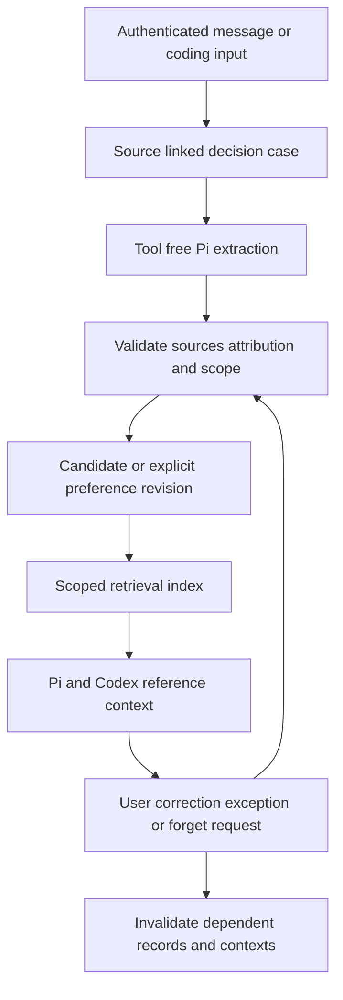

# Source grounded memory implementation plan

Date: 2026-11-12. Status: **proposed; implementation has not started**.

Extend RepoDesk's existing historical memory so that a user's decisions and
corrections can improve later coding work. Every recalled preference must have
retained evidence, a specific visibility and applicability scope, and a supported
way to correct or forget it. Memory remains reference data and never grants
permission to implement, publish, merge, deploy or change persistent instructions.

This plan follows the owner's discussion of noop and the agreed principles:
**traceable sources, explicit scope and correctability**. It covers internal memory
and its handoff to continuous Codex tasks. Task decomposition, multi-machine
scheduling and automatic decision answering are separate work.

## Existing implementation

The [historical memory design](../design/long-term-memory.md) and
[implementation evidence](implementation-status.md#private-and-shared-long-term-memory-2026-10-17)
establish the current baseline:

- Workspace JSONB holds historical entries, indexes, jobs, source dependencies,
  forgotten-source tombstones and disabled scopes.
- Private recall stays within one workspace, bot, private chat and actor. Shared
  recall stays within one workspace, bot, group and Topic. Private recall can
  cross that user's Topics; group recall cannot cross Topics.
- Tool-free Pi extraction and consolidation use durable claims, checkpoints,
  pinned provider configuration and recorded usage. Source edits, retention,
  revocation and forgetting invalidate dependent memory.
- `query_memories` provides authorized recall. `manage_memory` supports explicit
  remember, forget, enable and disable requests. Explicit notes preserve the
  user's message rather than a model-generated rule.

Existing records can summarize preferences, but their schema has no distinct
decision case, preference revision or explicit applicability fields. Historical
recall is documented separately from the coding runner. This plan makes those
contracts explicit and connects them without replacing existing memory.

Approved instructions and skills keep their current management and approval
contracts. Scheduled workflows remain outside historical recall. The optional
[Nowledge Mem adapter](nowledge-mem.md) keeps its private connection, exact-content
save and external retention boundaries; it is not a prerequisite for this work.

## Lessons from noop

The inspected noop revision is
[`e8dfb434720db09b48b0ae22fa62a59e7afe8662`](https://github.com/huacnlee/noop/commit/e8dfb434720db09b48b0ae22fa62a59e7afe8662).
The following observations inform the proposal rather than describe RepoDesk
features:

| Observed mechanism | Application to RepoDesk |
| --- | --- |
| [Closed decisions and correction feedback](https://github.com/huacnlee/noop/blob/e8dfb434720db09b48b0ae22fa62a59e7afe8662/src/decisions.ts#L65-L104) | Keep exact source references and distinguish a specific choice from a general preference. |
| [Shared and role-specific memory in execution prompts](https://github.com/huacnlee/noop/blob/e8dfb434720db09b48b0ae22fa62a59e7afe8662/src/runner.ts#L49-L69) | Supply a bounded, authorized memory snapshot to each coding attempt. |
| [Periodic learning and consolidation](https://github.com/huacnlee/noop/blob/e8dfb434720db09b48b0ae22fa62a59e7afe8662/src/sessions.ts#L166-L185) | Reuse Pi memory jobs to propose evidence-backed preferences, with application validation. |
| [Maintenance of principles and dated evidence](https://github.com/huacnlee/noop/blob/e8dfb434720db09b48b0ae22fa62a59e7afe8662/templates/agents/architect/profile.md#L8-L35) | Track revisions, exceptions, review dates and supersession explicitly. |

RepoDesk will retain application-owned PostgreSQL state. The first release needs
no filesystem memory mirror, vector database, additional service or dependency.
It will not import host Claude/Codex transcripts. Only received and currently
authorized application sources may contribute evidence.

## Product behavior

An authorized user makes a consequential choice or corrects a coding result. The
application preserves that case. Background extraction may propose a preference
with an applicability statement and source links. Later tasks receive relevant,
valid preferences as historical reference alongside the original requirements.

Users can ask what was remembered, why it applies, which sources support it,
correct its wording or scope, add an exception, and forget it. A natural-language
request must identify one record or a clearly bounded set before a mutation.
Ambiguous deletion or scope expansion requires resolving the missing target.

For example, choosing a modal for one repository's configuration editor first
creates a case limited to that task. An explicit statement such as “For this
repository's configuration screens, I prefer modal editors” can support a scoped
reference preference from one source. Repeated task-specific choices can support
a candidate, but do not establish a workspace-wide rule. A later exception for
bulk table editing narrows the applicable preference without changing unrelated
repositories or screens.

An explicit request to establish or change a persistent instruction continues
through the existing instruction workflow. Memory cannot silently edit approved
instructions, skills, repository AGENTS.md files or application policy.

## Records and storage

Extend the existing `MemoryState` with versioned, optional fields and initialize
missing fields when old workspaces load. Keep existing `MemoryEntry` records as
historical summaries. Use the following separate concepts; final TypeScript names
can follow the implementation's naming conventions.

| Record | Required content |
| --- | --- |
| Decision case | Stable ID; workspace and existing memory scope; contributing actors; original source IDs, hashes and retention bounds; question and chosen answer where present; task and input revision when applicable; evidence class; created time. Recommendations and assistant-reported outcomes remain separately attributed. |
| Preference revision | Stable preference ID and immutable revision ID; statement; visibility scope; applicability; supporting case/source IDs; evidence strength; exceptions; status; previous revision; correction actor/source; creation and review dates. |
| Memory use | Run or coding task/attempt identity; selected preference revisions and historical IDs; source snapshot hash; audience, actor and repository binding; context format version; usage time. |
| Derivation job | Existing claim/checkpoint fields plus phase, input digest, source and preference revision snapshots, model configuration and accounting identity. |

Evidence strength is an auditable category such as `explicit`, `repeated` or
`single_observation`, not a model's unverified probability. An accepted PR or a
successful check is outcome evidence; neither proves the user endorsed a general
preference. Silence, dismissing a question and generic thanks are not acceptance.

Use a small lifecycle: `candidate`, `active_reference`, `disputed`, `superseded`,
`expired` and `forgotten`. Automatic inference produces candidates. An exact,
explicit preference can become an active reference after source and scope
validation; a repeated-choice candidate remains historical evidence until the
user clearly accepts its stated scope. Current task requirements can proceed
without waiting for a candidate to be accepted.

Candidates are available for inspection and explanation, but are not injected as
active defaults. Task-specific cases may be recalled as attributed past examples.
Repeated evidence can strengthen a candidate without triggering repeated requests
for acceptance; ask only when the current work needs that unresolved choice.

Source validity overrides lifecycle status. Expired, edited, revoked or forgotten
evidence makes a record unavailable immediately, even before background cleanup.
Immutable revisions are immutable only while retained: erasure removes private
text and retains only the minimal content-free identifiers needed to prevent
replay or resurrection.

Keep a bounded aggregate. Initially share the existing 256-record memory capacity
across historical entries, decision cases and preference revisions containing
text, rather than adding an unbounded event log. Record only task-bound IDs and
hashes on usage snapshots. At capacity, prune invalid records and old unreferenced
candidates first; if no safe space remains, skip optional derivation and report a
content-free diagnostic. Never silently discard a live correction, forget marker
or source dependency to make room. Measure aggregate size before raising limits
or moving memory to tenant-scoped relational tables.

Source references need a source kind as well as an ID. A Telegram message and a
coding input/question event each require an application adapter that resolves
the retained content, actor, audience, content hash, expiry and current access.
The first release derives user preferences from authenticated Telegram sources
and their bound coding inputs/answers. GitHub comments and runner-generated
events remain independently checked task/outcome evidence until an adapter with
equivalent retention, authorship and erasure coverage is delivered.

## Visibility and applicability

Visibility decides who may read a record. Applicability decides when an authorized
reader may use it. Filtering by both happens before text enters a model context.

| Dimension | Rule |
| --- | --- |
| Tenant and bot | Every record, job, lookup, mutation and use belongs to one workspace and bot. |
| Private audience | Preserve the existing private chat and actor scope. Private preferences never enter a group task. |
| Shared audience | Preserve the existing group and Topic scope and speaker attribution. A participant's preference is not group consensus. |
| Repository | Store stable installation/repository IDs when applicable. A repository tag narrows use; it grants no repository access and does not widen audience visibility. |
| Task and domain | A case may be task-only. A preference may target configuration UI, reviews, tests or another explicit domain. Missing applicability defaults to the narrowest supported context. |
| Shared instructions | Workspace-wide rules use the existing approved instruction path. Version one adds no implicit workspace-wide memory scope. |

Private users can correct their own records. Group participants can correct only
records exclusively attributed to themselves; mixed-author/shared records require
the existing owner/admin authority. Every mutation rechecks the current actor and
source. Administrator status does not permit copying private content to a group.

A current explicit correction supersedes the older reference only within the
same owner, visibility and applicability. Conflicting statements from different
people remain attributed and disputed; recency alone cannot resolve them. Broader
use requires a new authorized statement with the intended audience and scope.

## Evidence and derivation pipeline

1. Capture deterministic event/source identity before optional model processing.
   Coding questions and answers retain the original task, input revision, actor
   and audience. Do not reconstruct consent from a model summary. Assistant
   conclusions, repository content and external tool output remain attributed
   reference evidence and cannot establish a user's preference by themselves.
2. Deduplicate by source identity and content revision. The same decision reaching
   Pi and Codex, appearing in several summaries or being replayed after restart
   counts once. A source edit invalidates its old case before re-extraction.
3. Extend the existing tool-free extraction path with schema-validated case and
   preference proposals. Bind proposed source IDs to the exact input snapshot.
   Model-proposed actor, scope, repository or authority changes cannot pass
   application validation. Preserve explicit uncertainty and exceptions.
4. Reuse the existing background claim, lease, checkpoint and retry mechanisms.
   Persist the new derivation phase before its provider call, settle accounting
   once and do not replay unknown provider outcomes. Revalidate source and model
   configuration before committing a revision.
5. Consolidate within one visibility scope. Merge equivalent evidence without
   counting duplicates, keep conflicting statements separate, and regenerate the
   index after corrections or pruning. A derivation failure leaves valid existing
   historical recall available and cannot block unrelated chat.

Use the originating request's configured memory model and existing remaining
memory/request/workspace budgets. Record distinct derivation usage if an extra
call is necessary. Do not add a separate judge call to every chat request or
introduce new coding execution-cycle or token quotas.

## Retrieval and coding handoff

Build one application-owned retrieval service for Pi and coding tasks. It first
checks membership, audience, enabled state, repository access, source validity and
preference revision. Only then rank eligible records by exact task/repository
match, applicability, explicit evidence, correction status and recency. Recent
but irrelevant records must not displace a directly applicable preference.

Use structured filters and literal search initially. Keep the existing recall
limit of 12 records, and fit preference and historical text into a combined
24,000-byte context ceiling. A fallback uses up to eight valid entries when the
index is unavailable. These are context bounds, not coding work quotas. Selection
must be reproducible from its inputs; retain an omitted-count marker without
exposing hidden records. Semantic retrieval can be evaluated later if fixtures
show useful evidence missed by this approach.

The reference pack contains statements, exceptions, evidence category, exact
revision IDs and authorized source pointers. It is visibly separated from the
current human request and approved instructions. Current instructions take
precedence over memory; application authorization is enforced independently.
Answering “why did you choose this?” can cite the retained source rather than
presenting a generated preference as something the user explicitly said.

For continuous coding tasks:

- Resolve memory against the confirmed modification target and originating
  Telegram audience. Follow-up GitHub inputs retain their independent provenance
  and permission checks; private context is not posted back to GitHub.
- Persist the selected revision/source snapshot with the task input cycle and
  attempt before dispatch. Supply only the bounded pack to intake, implementation,
  repair and read-only task questions where each phase is eligible. Repository
  content and a Codex session cannot write the canonical memory state.
- Revalidate included dependencies before subsequent model turns, delivery and
  publication. Removing a used source requires removing stale context and
  reassessing affected output from retained requirements. Hold publication when
  independence cannot be established; never replay an uncertain external write.
- Freeze selection within an execution boundary. A new explicit correction is
  consumed at the next controlled boundary. New unrelated memory must not cancel
  an unaffected task or change its implementation/publication grant.
- Reconstruct the same valid snapshot after restart. If its dependencies are no
  longer valid, rebuild context explicitly rather than restoring stale text from
  a Codex session or persisted prompt. The fixed verification plan remains intact.

Before asking a product question, Codex may use a directly applicable preference
to make an ordinary choice within the existing task grant. A material unresolved
conflict still needs a question. This release does not let a background judge
answer a durable question as the user or expand task authority.

## Corrections forgetting and retention

Extend `query_memories` to expose record kind, applicability, evidence, exceptions
and the current revision. Extend `manage_memory` with targeted correction and
exception operations, retaining its current-human-source validation. Persist a
new revision atomically with supersession and index invalidation. Return the
effective scope and what changed. Replays return the same mutation outcome.

The initial user interface is ordinary Telegram conversation through these tools.
For example: “Why do you think I prefer modals?”, “That only applies to settings
pages in repository A”, and “Forget that preference.” Listing and explanations
must obey the same visibility checks as execution. A future admin interface must
follow [UI rules](../design/ui-rules.md) and receive its own rendered acceptance
checks.

Keep the existing distinction between disabling recall and forgetting. Disabling
stops reading and generating in that scope while retaining eligible state.
Forgetting removes affected cases, revisions, indexes and dependent contexts,
with content-free tombstones preventing automatic re-extraction. Neither action
deletes original Telegram messages or external Mem records.

Retain the complete dependency union when consolidating multiple sources. Derived
content cannot outlive its earliest source retention boundary. Corrections and
preferences must also be removed from in-flight jobs, task context snapshots and
recoverable runner state through the existing erasure mechanism. Disable/forget
and deletion races must fence delayed commits. Routine logs contain fixed codes
and workspace/run/task identifiers, never preference text or private sources.

## Delivery phases

| Phase | Changes | Completion criteria |
| --- | --- | --- |
| M0 Contracts and fixtures | Define schemas, visibility/applicability rules, source adapters and a fixed evaluation corpus. Trace existing memory and coding erasure/accounting paths. | Cases distinguish an explicit preference, one-off choice, correction, observed outcome, conflict and quoted instruction. Each phase has an owner module and deterministic acceptance fixture. |
| M1 Records and user correction | Add optional versioned state, decision cases, preference revisions, query output, correction/exception mutations, source validation and erasure. | Old workspace snapshots load unchanged; exact mutations survive restart and replay; private/shared/repository boundaries and forget tombstones pass. Existing historical recall remains usable. |
| M2 Background derivation | Extend tool-free extraction and consolidation with candidate validation, duplicate handling, bounded capacity and accounting. | Two workers cannot commit the same job twice; stale scopes/sources cannot activate a preference; unknown provider outcomes do not replay; inferred candidates do not become broad rules. |
| M3 Pi and Codex recall | Add the shared selection service, bounded reference packs and coding snapshot/continuation integration. | New tasks, same-PR follow-ups, repair, task questions and restart consume only eligible revisions. Corrections affect the next boundary; source revocation blocks stale delivery/publication. No grant or verification plan changes. |
| M4 Evaluation and rollout | Run deterministic and controlled live evaluation, update current-behavior docs/examples, and enable in stages. | Zero scope leaks, authority changes or forgotten-content resurrection in the fixed corpus; live relevance and correction handling accepted before broad enablement. |

M0 precedes M1; M1 precedes M2 and M3. M4 begins after the complete correction-to-coding journey
works locally. Each phase should be independently reviewable; no new built-in
integration or deployment surface is required.

## Implementation areas

| Area | Existing files and proposed responsibility |
| --- | --- |
| State and validation | `src/memory/types.ts`, `state.ts`, `src/domain.ts`: versioned records, applicability, initialization, dependency validity and pruning. |
| Memory mutations | `src/memory/tools.ts`: authorized query, correction, exception, forgetting and idempotent outcomes. |
| Background work | `src/memory/planner.ts`, `service.ts`: phase snapshots, case/preference extraction, consolidation and accounting. |
| Case and selection logic | Proposed `src/memory/cases.ts` and `preferences.ts`: source adapters, evidence validation, revision transitions and deterministic selection. |
| Pi context | `src/agent/context.ts`, `tools.ts`: reference-pack injection and backward-compatible tool schemas. |
| Coding boundary | `src/coding/development.ts`, `local/conversation.ts`, `local/job.ts` and the relevant native/job prompt builders: persist, validate and transmit task-bound packs. A small `src/coding/memory.ts` adapter may keep orchestration readable. |
| Privacy | `src/privacy/service.ts` and existing coding erasure paths: remove derived records and snapshots transitively. |
| Verification | Extend `tests/integration/long-term-memory.test.ts`, coding integration fixtures and focused unit tests for new pure selection/revision logic. |

State extensions should not need a new SQL table. If implementation identifies
a relational requirement, revise this decision and include migration, restore and
rollback fixtures before increasing storage scope. Do not rewrite historical
summaries into preferences or infer retrospective authorization during upgrade.

## Acceptance and validation

The fixed corpus must include at least these scenarios, using synthetic retained
messages, fake Pi outputs and real isolated PostgreSQL where transaction behavior
matters:

| Scenario | Required result |
| --- | --- |
| One explicit scoped preference | One source can support its stated scope; no unrelated repository or UI context inherits it. |
| One task-specific choice repeated in summaries | One case, no inflated evidence count and no active general preference. |
| Explicit correction and narrower exception | New revision supersedes only the affected scope; old text leaves indexes and subsequent coding context. |
| Contradictory group participants | Both speakers remain attributed; no fabricated team consensus. |
| Foreign workspace, bot, private user, group or Topic | No memory text, titles or identifiers cross the visibility boundary. |
| Repository permission revoked | Tagged memory is unavailable before further use, delivery or publication. Unrelated repository tasks remain unaffected. |
| Quoted rule or malicious model/tool output | It cannot create an explicit preference, broaden scope, approve instructions or grant an external action. |
| Forget or source expiry during extraction and execution | Delayed commits and runner recovery cannot restore the content; derived outputs follow existing invalidation rules. |
| Disable followed by enable | Disabled scopes are not read or processed; re-enable restores only still-valid, non-forgotten records. |
| Duplicate events and concurrent corrections | Stable event identity, revision conflict detection and exactly one committed outcome. |
| Crash, provider timeout and unknown outcome | Valid checkpoints resume once; uncertain paid calls and external writes are not replayed. |
| Old workspace state and capacity reached | Existing recall still works; optional learning can skip safely without losing correction or forgetting state. |
| Analysis, question and implementation requests | Memory can inform an answer or permitted choice; it cannot convert analysis into coding or extend publication authority. |
| Missing memory index or no relevant record | A valid bounded fallback or empty pack lets ordinary work continue. |

Run `bun run check`, `bun run typecheck`, `bun test` and `bun run build` after
implementation, with disposable PostgreSQL for integration coverage. Run the
built Node runtime contract and ensure tool registration makes zero external
startup calls. If runner images or Compose change, build and smoke-test the exact
images and validate `docker compose config`. New UI requires focused deterministic
browser coverage and desktop/mobile rendering checks.

Controlled live evaluation should cover relevant recall, incorrect broadening,
correction propagation, repeated questions and user overrides across new and
continued coding tasks. Record model cost and context size with usefulness;
retrieval count alone is not a success measure. Live model calls, account
connections, Telegram messages and deployment require their own explicit scope.

## Rollout and recovery

Use a workspace switch for preference derivation and a recall target setting with
`off`, `pi` and `pi_and_coding` values. Both default off; existing historical recall
retains its current setting. Enable M1 controls first, then inspect candidate
output with recall off, then enable Pi recall and finally coding recall in a
pilot workspace.

Turning derivation or recall off immediately fences the corresponding new work.
Correction, listing and forgetting remain available. Disabling recall invalidates
affected active packs before further model use, delivery or publication; it does
not erase original tasks or authorize replay. Keep existing approved instructions
and source/grant checks in effect throughout recovery.

Before release, update the historical memory design, coding guide, user memory
guide, runnable examples and implementation-status evidence to describe only
delivered behavior. Keep this plan's phase status aligned with actual validation.
