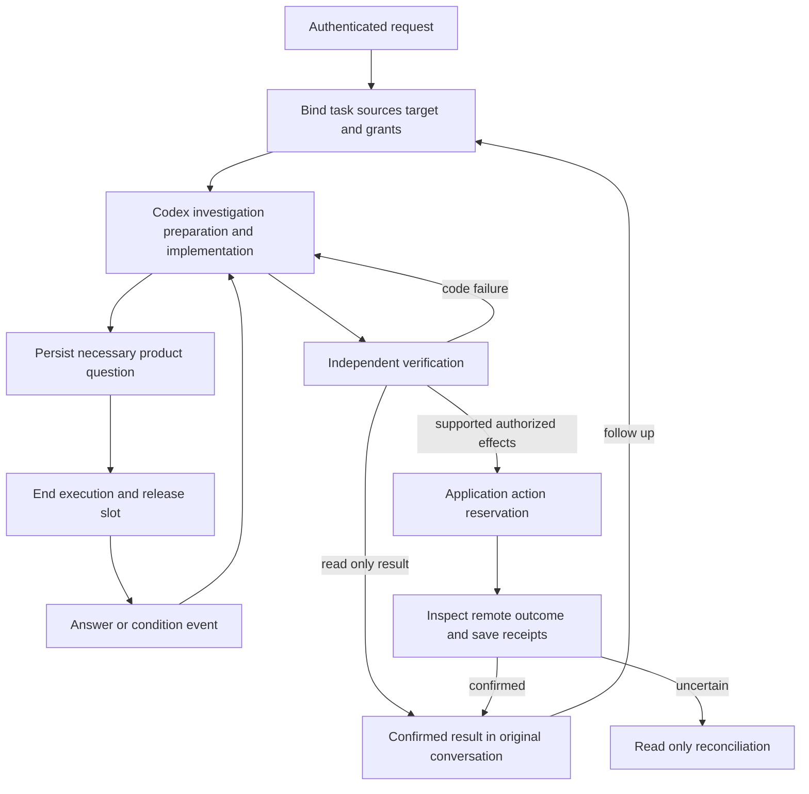

# Repository task collaboration release and memory plan

Date: 2026-11-12. Status: **local implementation and deterministic validation**.
P0–P4 are implemented; P5 retains controlled live model/Telegram/GitHub acceptance
and staged production rollout. See [current implementation](repository-tasks.md)
and [verification evidence](implementation-status.md#repository-tasks-release-effects-and-preference-memory-2026-11-12).

An authorized user should be able to ask RepoDesk to investigate a repository,
change it or release a version, then continue that work in the same Telegram
conversation. Pi coordinates the conversation. Codex reads the repository and
advances its engineering workflow. Application services preserve task state,
enforce authority and execute supported external actions. Source-grounded memory
improves later work without replacing current requirements or authorization.

This is the primary delivery plan for that workflow. The
[memory workstream](decision-memory-plan.md) retains the detailed evidence,
scope, correction and retention contracts; its delivery order follows this plan.

## Confirmed product decisions

1. Pi interprets new requests, continuations, factual questions and controls. It
   passes original requirements and relevant source references to Codex rather
   than rewriting a short request into a detailed engineering specification.
2. Repository work includes release preparation and other documented engineering
   procedures even when no business code needs changing. Codex investigates the
   current checkout and decides the technical steps.
3. Application services own durable state, actor and repository checks, ordering,
   credentials, external action receipts, cancellation and recovery. A repository
   document can describe a procedure but cannot authorize its side effects.
4. A task can outlive any Codex process, session or checkout. Execution ends when
   a bounded unit of work completes or waits; a later execution continues from
   durable evidence and current code.
5. Memory has traceable sources, explicit scope and correction/forgetting paths.
   A remembered preference is reference data, never an operation grant.

## Baseline when this plan was accepted

| Area | Existing behavior | Work in this plan |
| --- | --- | --- |
| Continuous coding | Original inputs, ordered follow-ups, product questions, read-only task questions, fixed verification, repair and one continuing PR. | Generalize task objectives and result contracts while preserving this path. |
| External writes | Application-owned PR publication and separately approved GitHub PR merge/close actions. | Add typed release operations with independent grants and durable recovery. |
| Codex lifecycle | `runConversation` starts `codex app-server` and terminates the child in `finally`. Compatible retained sessions can resume; missing sessions reconstruct. | Make process-independent continuation explicit for repository and release tasks. |
| Historical memory | Scoped workspace JSONB records, Pi extraction/consolidation, source invalidation and user forgetting controls. | Add decision cases, preference revisions and authorized task context snapshots. |
| Release procedures | Repository files can provide engineering context. Existing coding publication produces a PR, not a general version release. | Read the pinned procedure, prepare and verify a release, then perform supported release actions. |

The implementation baseline is documented in
[Codex tasks](codex-coding.md), [runner lifecycle](codex-runner.md#lifecycle-and-recovery),
[PR actions](github-app.md#merge-or-close-a-pr-from-telegram), and
[historical memory](../design/long-term-memory.md). Current code includes
`DevelopmentTask`, ordered relational task inputs and fenced attempts in
`src/coding/development.ts` and `task-store.ts`. Reuse these foundations instead
of building a second competing task engine.

The noop reference is the inspected
[`e8dfb434720db09b48b0ae22fa62a59e7afe8662`](https://github.com/huacnlee/noop/commit/e8dfb434720db09b48b0ae22fa62a59e7afe8662)
revision. Its durable task continuation, waiting and evidence-backed learning
inform this design. Multi-agent task decomposition, a machine fleet and automatic
decision answering remain later projects, not prerequisites for these journeys.

## Responsibilities and routing

| Situation | Pi | Codex | Application services |
| --- | --- | --- | --- |
| Greeting or simple factual lookup | Answer using available authorized context/tools. | No execution required. | Enforce normal tool and audience access. |
| Repository investigation requiring a checkout or technical work | Relay the goal, target and original sources. | Inspect files, explain findings and identify missing evidence. | Start a read-only task/attempt with no implementation grant. |
| Feature or fix | Start or continue the matching task. | Investigate, implement, test and repair. | Serialize inputs, enforce grants and verify/publish the PR. |
| Release a version according to repository documentation | Relay the request, repository, requested version/channel and document reference. | Read the procedure, resolve technical steps, prepare changes/artifacts and verify readiness. | Validate and execute only supported release effects within the recorded grant. |
| Status or explanation during work | Read durable task state; ask the task for a fresh answer when necessary. | Answer technical questions in the existing authorized task context. | Preserve the work result and keep questions separate from implementation inputs. |
| Stop or correction | Route controls promptly and preserve the user's wording. | Consume corrections at controlled execution boundaries. | Fence execution/effects; append an input revision; preserve confirmed remote results. |

Codex should investigate facts it can obtain itself. Ask the user only for an
unresolved target or consequential choice. A missing runner, source checkout or
release adapter is an application blocker with recovery guidance, not a request
for the user to provide an internal container path or repeat authorization.

## One durable repository task

Extend the existing task model with a versioned objective such as `development`,
`investigation` or `release`. The objective describes the work; grants determine
what it may do. Existing records default to their current development behavior
and acquire no new authority during upgrade.

Keep one task per user goal rather than attaching every message in a Topic to
the latest task. Clear continuations append an input revision; distinct goals
start a new task with an explicit relationship when useful. Extending existing
development work into a release requires a recorded objective transition and a
fresh release grant, never reuse of the old coding grant. A release's preparatory
PR remains an artifact of that same release task.

Use a discriminated result contract:

| Result | Completion evidence |
| --- | --- |
| Investigation complete | Findings, source/commit references, limitations and any checks performed. No patch or PR is required. |
| Change ready for review | Verified input revision, patch and fixed check evidence, confirmed branch/PR identity. |
| Release prepared | Procedure references, exact target/version/channel, prerequisite results and artifact/action manifest. Clearly state that publication remains pending. |
| Release complete | Confirmed receipts for every required effect and final version/artifact links. An agent's claim alone cannot complete it. |
| Waiting or blocked | Durable condition/question identity, completed preparation, remaining work and an application-readable reason. |

Do not force release or investigation outcomes through the current nonempty-patch
and PR-completion path. Preserve current development PR readiness and verification
behavior. In particular, the existing `canPublish` flag remains authority for its
current PR publication contract; it cannot become a release permission.

The task stores the authenticated objective and inputs, latest/consumed/verified
revisions, actor/audience, repository/connection binding, attempts and fences,
procedure references, selected memory revisions, verification evidence, pending
questions/waits, action receipts and confirmed artifacts. Use short transactions
for claims/state transitions and perform model, provider and GitHub calls outside
database locks. One fenced executor mutates a task checkout at a time.

The following states describe the proposed logical lifecycle, not a claim about
the current `DevelopmentState` enum:

## Process lifetime waiting and continuation

The application worker/supervisor can stay running; each task's Codex child is
temporary. End its process when the execution returns a result, necessary question
or waiting condition. Preserve a checkpoint before freeing compute. Required
task-channel transcript flushing and credential cleanup still finish before a
conflicting execution starts.

Persist waits as typed conditions, such as an exact CI run, a PR at an expected
head, or an existing approval ID. Application-owned read adapters or verified
webhooks observe them with bounded backoff. Model output must not become an
arbitrary supervisor shell command. A completed CI failure wakes repair work;
observing a changed state is not evidence that verification passed. Human waits
do not expire into consent or repeatedly wake Codex on a timer.

Later work starts a fresh Codex process. Resume a compatible, valid retained
session when available. Otherwise reconstruct from original inputs, decisions,
current checkout, completed steps, source/memory snapshots and effect receipts.
Device-login temporary session cleanup and checkout retention remain explicit;
neither a live process nor unlimited session retention is required for continuity.

Received follow-ups enter the next controlled boundary in revision order. A
read-only question never becomes permission to mutate or release. Repeated
events, restart and Stop must not duplicate preparation, payment accounting or
external effects. Stopping preserves confirmed PRs, tags and releases; already
dispatched uncertain actions still require reconciliation.

## Release journey

The representative request is: “Release repository A as v1.2.0 following
`docs/release.md`.” The complete journey remains one task with one conversation.

1. **Bind the request.** Resolve the authorized repository and originating
   audience. Preserve the exact request and document reference. If repository
   rules unambiguously determine a missing version within the request's scope,
   Codex can calculate it; otherwise ask for the missing choice after inspecting
   the repository. Do not ask the user to invent setup or check commands.
2. **Read the procedure.** Prepare an authenticated checkout pinned to a commit.
   Codex reads applicable AGENTS.md files, the release guide, manifests, scripts
   and relevant CI configuration. Record document paths, commits and content
   hashes. Read linked internal files as needed. Treat their text as procedure
   data subject to current user instructions and application policy.
3. **Prepare the release.** Inspect versions, previous tags, changes, branch/PR
   state and required build/test evidence. Prepare version/CHANGELOG changes,
   release notes, checks and artifacts as the procedure requires. Preserve fixed
   verification plans through repair. Local verification and artifact creation
   run without publication credentials.
4. **Satisfy prerequisites.** If changes need a PR, use the current ready-for-review
   publication path and retain that PR in the task. Existing exact-PR merge
   approval requirements continue to apply. Pin the final release commit after
   the required merge, then validate checks/artifacts against that commit. If CI
   must finish, save its exact wait condition and close the Codex execution.
5. **Execute supported effects.** Codex returns a structured action manifest.
   Application services validate it against the authenticated release grant,
   prerequisites and current target, reserve each effect and execute using the
   appropriate scoped credentials. Required but unsupported steps remain named
   blockers; do not silently omit them and report the version as published.
6. **Confirm the result.** Read back the remote tag, release and artifact identities
   as appropriate. Record links and receipts. Report publication only when all
   required steps are confirmed; retain partial success if a later step fails.

A procedure manifest names the procedure snapshot, final target commit,
version/tag/channel, preparation/check evidence, artifact handles and digests,
ordered dependencies and typed external actions. Model-reported verification is
independently checked by the application. A branch or procedure change outside
the validated snapshot requires reassessment before further effects; it cannot
silently change what is being released.

Persist artifacts by tenant/task/attempt with immutable hashes, bounded size and
retention tied to the task. Missing or expired artifacts require re-preparation
and verification, never substitution by matching filename. Artifact storage does
not imply a running checkout or Codex process. Transport services may upload
verified artifacts, but must not execute repository scripts with release secrets.

## Supported release operations and authorization

The first release adapter will support creating a GitHub tag at an exact verified
commit, creating the corresponding GitHub Release with explicit draft/prerelease
state, and uploading retained verified assets when required. Required CI/check
reads must have their own scoped adapter before a procedure depending on them is
enabled. Existing tags/releases are inspected and described accurately as
pre-existing, task-created or conflicting.

Package registry publication, deployment, arbitrary workflow dispatch and
cross-repository releases need separate adapters and acceptance coverage. A
repository whose procedure depends on one of these can receive a prepared result
and an explicit unsupported-step blocker. It cannot receive a false release-complete
result. Keep the current protection against coding publication of `.github/`
changes; editing release automation is not an incidental permission expansion.

A clear authenticated release instruction can ground a release grant under an
enabled repository policy when its repository, target/version, destination and
allowed effects are unambiguous. Do not ask again before every local preparation
or ordinary technical choice. Where an existing approval or expanded scope is
required, prepare the exact reviewable operation first and ask only for that
remaining decision. The current separate PR merge approval contract is preserved.

Release grants bind the actor, tenant/bot/audience, installation/repository,
authenticated source/input revision, permitted operation types, version/tag,
target commit or permitted target-resolution rule, channel/destination and policy
revision. Each action also binds its exact prepared payload and expected remote
state. Existing coding grants, preference records, repository instructions and
the Codex model's classification cannot independently supply this authority.

Credentials stay in application services or dedicated credential-isolated action
adapters. Codex receives artifact handles and operation results rather than an
unrestricted publication token. If an adapter needs additional upstream scopes,
change permission discovery/setup and require the service's normal explicit
grant process; never widen existing installations silently. Tag-triggered
automation is part of an action's consequences and must fit the release scope.

## External action receipts and recovery

Add a tenant-scoped action ledger associated with the existing repository task.
Use a dedicated SQL migration for uniqueness/claim constraints where needed,
without renaming or recreating the current task tables.

Each record includes task/action ID, actor and source/grant revision, operation,
payload digest, exact target/version/destination, dependency receipts, fence,
reservation/dispatch times, remote IDs and sanitized result. Uniqueness covers
both the task's action identity and competing claims for the same repository,
version/tag and destination. One task cannot bypass a conflict by inventing a new
action ID or using a different spelling for the same target.

Local uniqueness applies within the tenant. Expected-state checks and upstream
create-if-absent semantics must also handle another workspace or external actor
using the same remote target, without revealing that actor's private task data.

Use states equivalent to `reserved`, `dispatched`, `confirmed`, `failed`,
`unknown` and `cancelled`. Persist before dispatch; recheck current authority and
expected remote state immediately before acting. A confirmed receipt is returned
on duplicates. Retry a proven non-dispatch or confirmed safe rejection under the
same identity; an ambiguous network result or crash after dispatch enters
read-only reconciliation rather than replay.

Reconciliation compares the exact commit, version/tag, release payload and asset
identity/digest where available. Matching names alone cannot establish success.
If proof is incomplete or remote content conflicts, preserve an unknown/conflict
state for inspection. Confirmed earlier effects remain recorded. Do not delete a
tag/release, force-push or unpublish a package as automatic rollback.

Task cancellation and permission/source revocation fence future effects without
pretending to undo completed writes. User-facing status distinguishes prepared,
waiting for approval/CI, published, partially published, failed and unknown.

## Memory across task executions

Deliver the detailed [memory workstream](decision-memory-plan.md) around this task
model. Store raw decision evidence separately from preference revisions. Preserve
workspace/bot/private-actor or group/Topic visibility; repository and task tags
narrow applicability without granting access or widening the audience.

The application builds a bounded reference pack containing eligible historical
cases, active scoped preferences, exceptions, revision IDs and source pointers.
Record the pack's dependency snapshot on the task execution. Fresh Codex processes
receive this pack with the original requirements and current repository evidence;
canonical memory is not written by a Codex process or copied from its session.

Capture useful authored choices and corrections through durable task/input events
for tool-free Pi extraction. Model claims of success, passing CI and publication
receipts are outcome evidence, not user preference endorsements. An exact explicit
preference can support its stated scope from one source; repeated specific choices
remain candidates until their proposed broader scope is clearly accepted.

Corrections create revisions and invalidate affected indexes and in-flight packs.
Forget/source expiry removes derived content and fences delayed jobs or session
recovery from restoring it. Preserve content-free tombstones and the complete
source dependency union. Existing instruction/skill approval and optional
Nowledge Mem export contracts remain separate.

For a later release, always inspect the current pinned release procedure. Memory
may recall a scoped channel preference or a previous decision; it cannot replace
the current guide, reuse an old version/commit or authorize a new publication.

## Delivery sequence

The table records the accepted contracts. Local code and fixtures implement
P0–P4. P5's offline checks are part of this change; live acceptance and broad
enablement remain operational release gates. New objectives, preference
derivation and automatic Pi/Codex preference recall are enabled by default
when settings are absent, following the owner's 2026-11-12 instruction. Explicit
disable settings and per-action authorization remain enforced.

| Phase | Scope | Observable completion |
| --- | --- | --- |
| P0 Task and action contracts | Freeze objective/result schemas, routing rules, lifecycle boundaries, grant types, source adapters and synthetic journey fixtures. | Investigation, code change and release requests route correctly; no task type or model result grants itself release authority. |
| P1 Durable repository execution | Extend the current task engine, typed waits, process-independent checkpoints and reconstruction; preserve development compatibility. | Process exit, user input, CI change and supervisor restart continue the same task; analysis is not forced to produce a patch/PR; no duplicate effects or usage. |
| P2 Decision memory and recall | Implement memory M0–M3: cases, preference revisions, correction/forgetting, tool-free derivation and Pi/Codex packs. | A scoped correction influences the next eligible execution and is explainable; source loss/forgetting cannot leak through indexes or restored sessions. |
| P3 Release preparation | Read pinned repository procedures, prepare version/notes/artifacts, integrate fixed verification, current PR/merge paths and prerequisite waits. | A repository fixture produces an independently verified prepared manifest, even when the workflow needs no code patch; pending publication is explicit. |
| P4 GitHub release effects | Add action ledger/migration, tag/Release/asset adapter, scoped grants, conflicts and read-only reconciliation. | A synthetic end-to-end release confirms exact remote artifacts once; two workers/tasks, restart and uncertain responses cannot duplicate or falsely complete publication. |
| P5 Evaluation and rollout | Complete memory M4, run controlled real journeys, update current-behavior docs and stage deployments. | No boundary/authority/erasure violations; release completion and correction usefulness accepted in the pilot before broad enablement. |

P0 precedes P1. P2 follows the stable task/source contracts in P1. P3 and P4 build
on P1, with P4 requiring P3's manifest and prerequisite evidence. The integrated
P5 journey includes memory-enabled continuation; release correctness does not
depend on optional preference recall being enabled.

## Implementation areas

| Responsibility | Starting points |
| --- | --- |
| Pi routing and handoff | `src/agent/context.ts`, `tools.ts`, `work-handoff.ts`, `src/coding/extension.ts`: original-input routing, task controls and accurate capability descriptions. |
| Durable task model | `src/coding/development.ts`, `tasks.ts`, `task-store.ts`, `executor.ts`, conversation stores/executors: versioned objectives/results, grants, ordering and waits. |
| Codex execution | `src/coding/local/job.ts`, `conversation.ts`, native/sandbox drivers: procedure and context inputs, checkpoint/export, process cleanup and reconstruction. |
| Release preparation | `src/releases/prepare.ts` and `types.ts`: procedure/artifact manifests and application validation around Codex's decisions. |
| Release effects | `src/releases/service.ts`, `github.ts` and migration 023: typed adapters, SQL reservations, target conflicts and reconciliation. |
| Memory | `src/memory/types.ts`, `state.ts`, `planner.ts`, `service.ts`, `tools.ts` and small case/preference modules as specified in the workstream. |
| Privacy and diagnostics | Existing privacy/coding cleanup paths: remove retained artifacts and private task/memory context; keep fixed diagnostics and content-free replay protection. |
| Verification | Existing development, coding runtime and long-term-memory tests plus focused release fixtures and production-composition checks. |

Reuse the standalone backend/worker and existing PostgreSQL/queue deployment.
No additional agent service, vector store or model provider is required. Optional
state fields preserve legacy task behavior. Additive action-ledger migrations
must have upgrade, repeated-migration, backup/restore and rollback-behavior tests.
No migration may reinterpret a historical coding grant as release consent.

## Acceptance journeys and failure cases

Use fake model/GitHub transports and isolated real PostgreSQL. Exercise at least
the following user-visible contracts through production composition:

| Journey | Required behavior |
| --- | --- |
| Explain a repository without requesting changes | Read-only findings; no implementation, PR or release effect. |
| Fix a bug and continue after completion | Existing same-task/same-PR behavior and ready-for-review result remain intact. |
| Release using an internal guide | Codex receives original input and pinned files; Pi does not invent the technical procedure. |
| Release needs no code change | Valid preparation/release results without a fabricated patch or unnecessary PR. |
| Preparation requires changes and a merge | Prepare/review PR first, honor existing exact-PR approval, then validate the final release commit. |
| CI or user input arrives after Codex exits | Persisted wait wakes a new execution under the same task ID, with correct source and memory snapshots. |
| Procedure, target head or artifact changes | Reject stale readiness and reassess before the next effect; never publish the wrong bytes/commit. |
| Unsupported registry/deploy/dispatch step | Name the blocker and completed preparation; never report a complete release. |
| Duplicate request, concurrent task or worker | One action reservation per target; confirmed results returned without a duplicate release. |
| Lost network response or restart after dispatch | Read-only reconciliation or unknown status; no blind replay or fabricated success. |
| Partial publication then Stop/revocation | Confirmed artifacts remain visible; future effects are fenced and uncertain effects reconciled. |
| Correction or forgetting during execution | Affected packs and derived output are invalidated; retained sessions cannot restore forgotten content. |
| Foreign workspace/user/group/Topic or repository | No cross-scope context, credentials, artifacts, actions or hidden identifiers. |
| Malicious repository guide or memory | No credential exposure, policy changes, unauthorized commands in the supervisor or broadened grants. |
| Old task and workspace snapshots | Load with existing semantics; missing feature settings adopt enabled defaults, explicit disables persist, and historical authorities remain unchanged. |

Run `bun run check`, `bun run typecheck`, `bun test`, `bun run build` and the built
Node runtime contract after implementation. New built-in tool registration must
use bundled definitions and local state, with zero external startup calls; extend
`scripts/fixtures/plugin-startup.ts` and production-composition regression checks
when adding registrations. If images/Compose change, build and smoke-test the
exact images and run `docker compose config`.

The first interface is ordinary Telegram conversation using existing task
status/history/controls. A new management UI, if needed, must apply
[UI rules](../design/ui-rules.md), inspect comparable shared components and verify
display/editor, pending/error and desktop/mobile states before completion.

## Rollout and operational recovery

Roll out compatible application and task/result protocol support together before using new objectives. Workers
and supervisors advertise supported protocol/actions; mixed versions fail closed
on unknown kinds while continuing compatible existing coding tasks. Investigation and supported GitHub release objectives are available by default
for selected repositories after Codex/GitHub setup; owner/admin overrides can
disable them per repository.
Keep memory derivation and recall targets independently controllable as described
in its workstream.

Start with local fixtures, then inspect release-preparation output without
external publication. Exercise GitHub release effects in a dedicated pilot repository after
setup/permissions and recovery checks, using a current explicit release request. A live model call,
account connection, Telegram send or actual publication needs separately scoped
authorization; writing this plan performs none of those actions.

Disabling an objective/adapter fences new starts and future unperformed effects;
inspect/reconcile already dispatched effects and preserve confirmed results.
Drain affected work before rolling back binaries, retain additive ledger data,
and never run a destructive down migration or restart uncertain writes. Original
development work and historical recall remain available where their policies and
dependencies are still valid.

Before release, update the coding guide, runner lifecycle, GitHub capabilities,
user workflows, memory guide, runnable examples and implementation-status evidence
to distinguish prepared releases from actually published versions. Measure
completion correctness, recovery, repeated questions, relevant recall and cost;
the number of agents or model calls is not a delivery metric.
